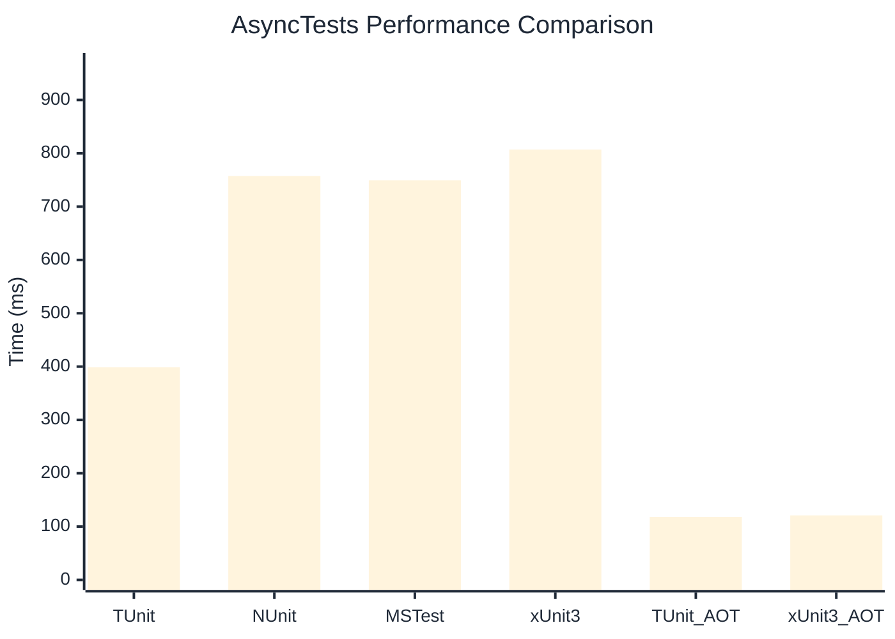

# AsyncTests Benchmark

> Realistic async/await patterns with I/O simulation

:::info Last Updated
This benchmark was automatically generated on **2026-10-18** from the latest CI run.

**Environment:** Ubuntu Latest • .NET SDK 10.0.402
:::

## 📊 Results

| Framework | Version | Mean | Median | StdDev |
|-----------|---------|------|--------|--------|
| **TUnit** | 1.75.0 | 398.9 ms | 398.3 ms | 6.45 ms |
| NUnit | 5.0.0 | 757.5 ms | 753.7 ms | 14.86 ms |
| MSTest | 4.5.1 | 749.2 ms | 751.9 ms | 21.61 ms |
| xUnit3 | 4.0.2 | 807.0 ms | 803.2 ms | 17.30 ms |
| **TUnit (AOT)** | 1.75.0 | 118.1 ms | 118.1 ms | 0.43 ms |
| xUnit3_AOT | 4.0.2 | 121.0 ms | 121.1 ms | 0.65 ms |

## 📈 Visual Comparison

## 🎯 Key Insights

This benchmark compares TUnit's performance against NUnit, MSTest, xUnit3, xUnit3_AOT using identical test scenarios.

---

:::note Methodology
View the [benchmarks overview](/docs/benchmarks) for methodology details and environment information.
:::

*Last generated: 2026-10-18T00:34:22.692Z*
