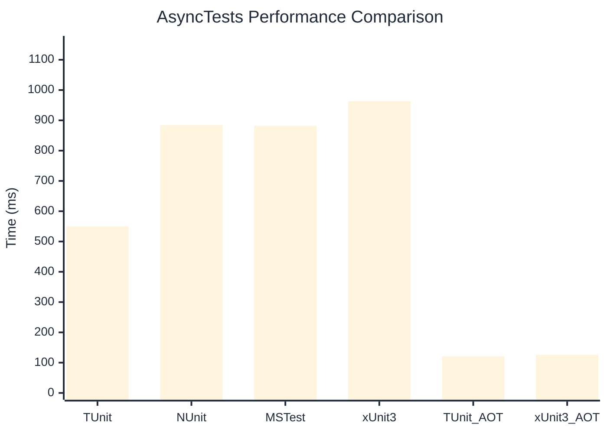

# AsyncTests Benchmark

> Realistic async/await patterns with I/O simulation

:::info Last Updated
This benchmark was automatically generated on **2026-11-01** from the latest CI run.

**Environment:** Ubuntu Latest • .NET SDK 10.0.403
:::

## 📊 Results

| Framework | Version | Mean | Median | StdDev |
|-----------|---------|------|--------|--------|
| **TUnit** | 1.76.28 | 549.6 ms | 549.0 ms | 47.19 ms |
| NUnit | 5.0.0 | 884.3 ms | 857.2 ms | 96.04 ms |
| MSTest | 4.5.2 | 882.0 ms | 850.3 ms | 106.25 ms |
| xUnit3 | 4.0.2 | 963.1 ms | 961.0 ms | 96.87 ms |
| **TUnit (AOT)** | 1.76.28 | 120.6 ms | 120.5 ms | 2.06 ms |
| xUnit3_AOT | 4.0.2 | 126.1 ms | 126.2 ms | 3.56 ms |

## 📈 Visual Comparison

## 🎯 Key Insights

This benchmark compares TUnit's performance against NUnit, MSTest, xUnit3, xUnit3_AOT using identical test scenarios.

---

:::note Methodology
View the [benchmarks overview](/docs/benchmarks) for methodology details and environment information.
:::

*Last generated: 2026-11-01T00:31:22.050Z*
