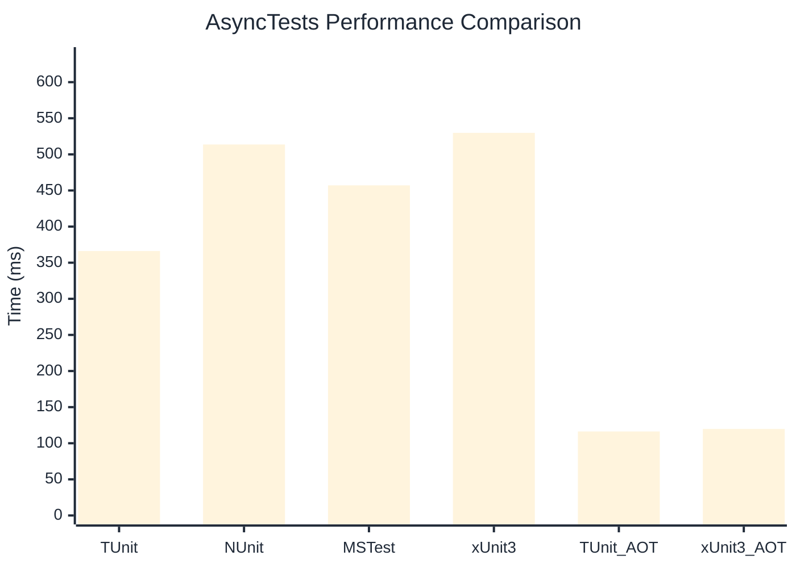

# AsyncTests Benchmark

> Realistic async/await patterns with I/O simulation

:::info Last Updated
This benchmark was automatically generated on **2026-11-12** from the latest CI run.

**Environment:** Ubuntu Latest • .NET SDK 11.0.100
:::

## 📊 Results

| Framework | Version | Mean | Median | StdDev |
|-----------|---------|------|--------|--------|
| **TUnit** | 1.84.0 | 366.2 ms | 370.3 ms | 15.91 ms |
| NUnit | 5.0.0 | 513.7 ms | 501.5 ms | 29.39 ms |
| MSTest | 4.5.3 | 457.1 ms | 457.3 ms | 20.94 ms |
| xUnit3 | 4.0.3 | 529.8 ms | 531.3 ms | 29.94 ms |
| **TUnit (AOT)** | 1.84.0 | 116.3 ms | 116.3 ms | 0.76 ms |
| xUnit3_AOT | 4.0.3 | 119.8 ms | 119.8 ms | 0.28 ms |

## 📈 Visual Comparison

## 🎯 Key Insights

This benchmark compares TUnit's performance against NUnit, MSTest, xUnit3, xUnit3_AOT using identical test scenarios.

---

:::note Methodology
View the [benchmarks overview](/docs/benchmarks) for methodology details and environment information.
:::

*Last generated: 2026-11-12T22:35:43.064Z*
