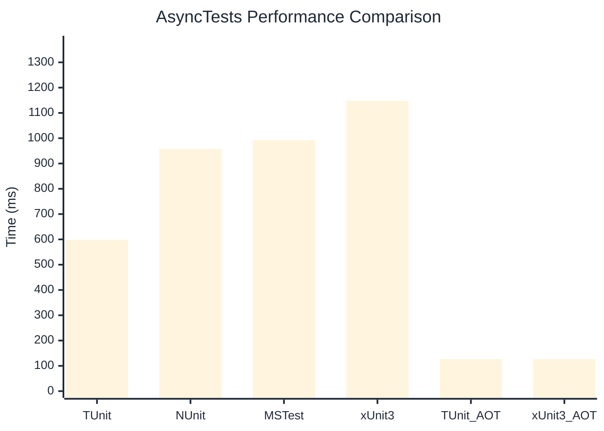

# AsyncTests Benchmark

> Realistic async/await patterns with I/O simulation

:::info Last Updated
This benchmark was automatically generated on **2026-10-25** from the latest CI run.

**Environment:** Ubuntu Latest • .NET SDK 10.0.402
:::

## 📊 Results

| Framework | Version | Mean | Median | StdDev |
|-----------|---------|------|--------|--------|
| **TUnit** | 1.76.0 | 598.2 ms | 600.4 ms | 59.39 ms |
| NUnit | 5.0.0 | 957.5 ms | 932.0 ms | 132.38 ms |
| MSTest | 4.5.1 | 992.6 ms | 994.4 ms | 123.62 ms |
| xUnit3 | 4.0.2 | 1,148.3 ms | 1,144.4 ms | 62.78 ms |
| **TUnit (AOT)** | 1.76.0 | 126.2 ms | 126.2 ms | 2.71 ms |
| xUnit3_AOT | 4.0.2 | 126.3 ms | 125.9 ms | 3.35 ms |

## 📈 Visual Comparison

## 🎯 Key Insights

This benchmark compares TUnit's performance against NUnit, MSTest, xUnit3, xUnit3_AOT using identical test scenarios.

---

:::note Methodology
View the [benchmarks overview](/docs/benchmarks) for methodology details and environment information.
:::

*Last generated: 2026-10-25T00:37:19.570Z*
