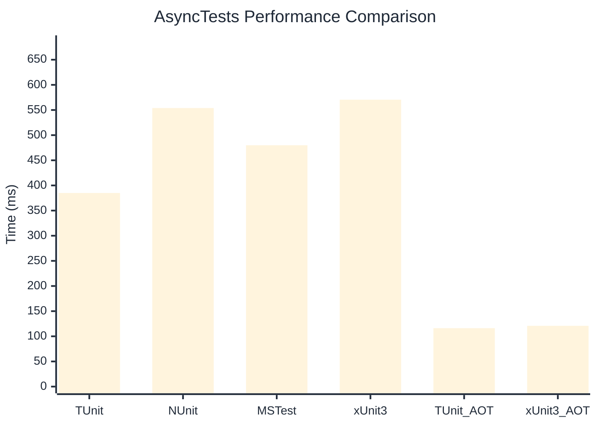

# AsyncTests Benchmark

> Realistic async/await patterns with I/O simulation

:::info Last Updated
This benchmark was automatically generated on **2026-11-22** from the latest CI run.

**Environment:** Ubuntu Latest • .NET SDK 11.0.100
:::

## 📊 Results

| Framework | Version | Mean | Median | StdDev |
|-----------|---------|------|--------|--------|
| **TUnit** | 1.87.12 | 385.0 ms | 388.1 ms | 18.42 ms |
| NUnit | 5.0.0 | 553.9 ms | 554.1 ms | 33.73 ms |
| MSTest | 4.5.3 | 479.9 ms | 474.6 ms | 28.62 ms |
| xUnit3 | 4.0.3 | 570.5 ms | 569.8 ms | 25.60 ms |
| **TUnit (AOT)** | 1.87.12 | 116.2 ms | 116.3 ms | 0.57 ms |
| xUnit3_AOT | 4.0.3 | 120.9 ms | 120.8 ms | 0.73 ms |

## 📈 Visual Comparison

## 🎯 Key Insights

This benchmark compares TUnit's performance against NUnit, MSTest, xUnit3, xUnit3_AOT using identical test scenarios.

---

:::note Methodology
View the [benchmarks overview](/docs/benchmarks) for methodology details and environment information.
:::

*Last generated: 2026-11-22T00:26:14.011Z*
