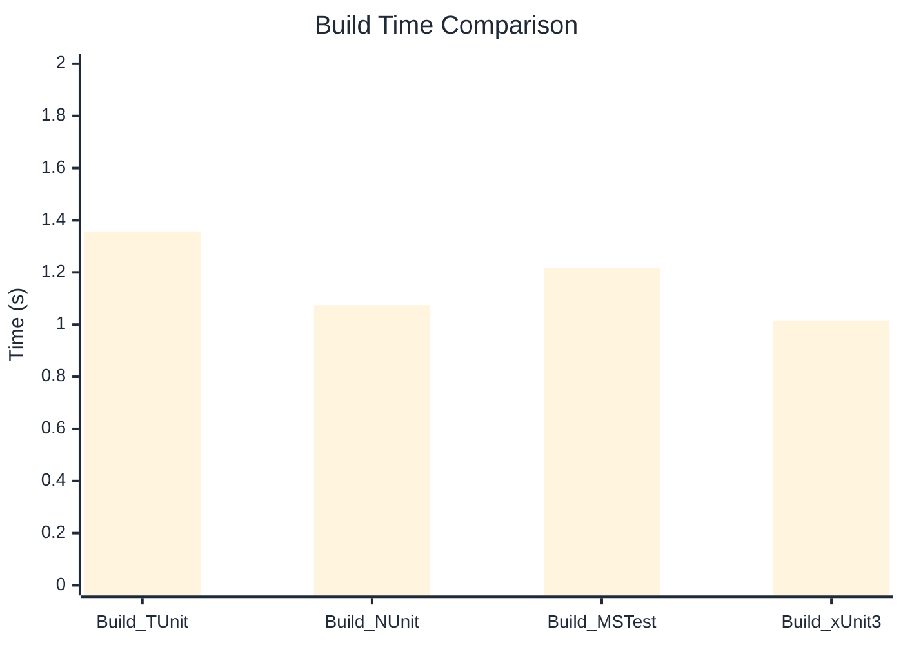

# Build Performance Benchmark

> Compilation time from a clean build across frameworks — how long it takes to build an identical test project.

:::info Last Updated
This benchmark was automatically generated on **2026-10-18** from the latest CI run.

**Environment:** Ubuntu Latest • .NET SDK 10.0.402
:::

## 📊 Results

Compilation time comparison across frameworks:

| Framework | Version | Mean | Median | StdDev |
|-----------|---------|------|--------|--------|
| **TUnit** | 1.75.0 | 1.357 s | 1.305 s | 0.1803 s |
| Build_NUnit | 5.0.0 | 1.074 s | 1.083 s | 0.1168 s |
| Build_MSTest | 4.5.1 | 1.218 s | 1.207 s | 0.0834 s |
| Build_xUnit3 | 4.0.2 | 1.016 s | 1.012 s | 0.0390 s |

## 📈 Visual Comparison

---

:::note Methodology
View the [benchmarks overview](/docs/benchmarks) for methodology details and environment information.
:::

*Last generated: 2026-10-18T00:34:22.694Z*
