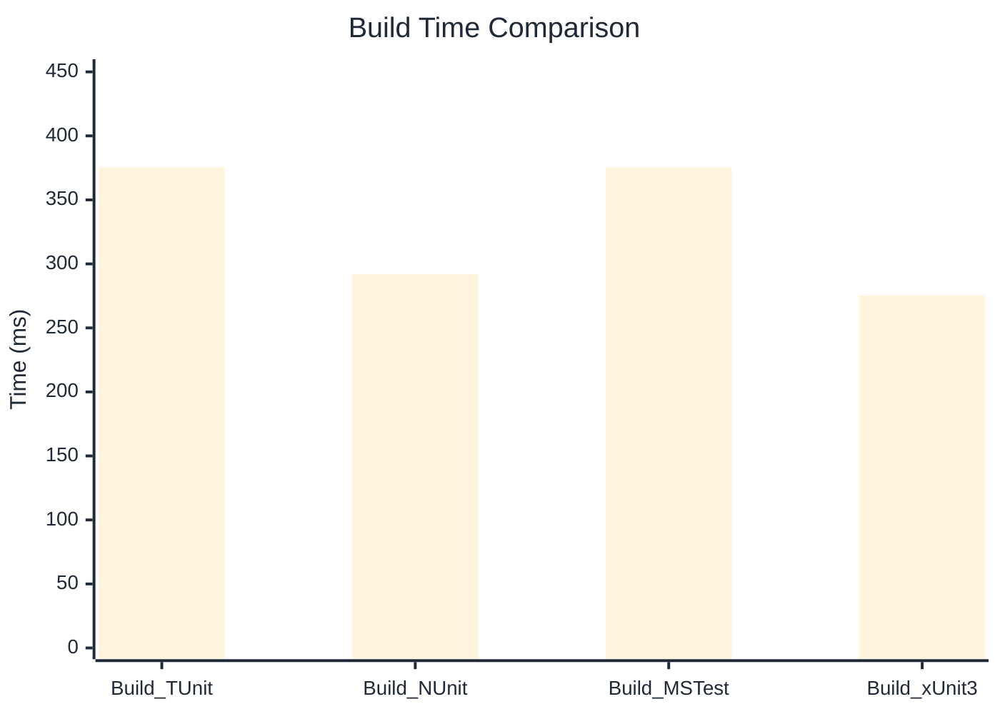

# Build Performance Benchmark

> Compilation time from a clean build across frameworks — how long it takes to build an identical test project.

:::info Last Updated
This benchmark was automatically generated on **2026-11-11** from the latest CI run.

**Environment:** Ubuntu Latest • .NET SDK 11.0.100
:::

## 📊 Results

Compilation time comparison across frameworks:

| Framework | Version | Mean | Median | StdDev |
|-----------|---------|------|--------|--------|
| **TUnit** | 1.83.0 | 375.5 ms | 347.8 ms | 74.95 ms |
| Build_NUnit | 5.0.0 | 291.9 ms | 289.9 ms | 18.41 ms |
| Build_MSTest | 4.5.2 | 375.4 ms | 373.7 ms | 17.18 ms |
| Build_xUnit3 | 4.0.3 | 275.5 ms | 275.0 ms | 10.12 ms |

## 📈 Visual Comparison

---

:::note Methodology
View the [benchmarks overview](/docs/benchmarks) for methodology details and environment information.
:::

*Last generated: 2026-11-11T00:47:49.901Z*
