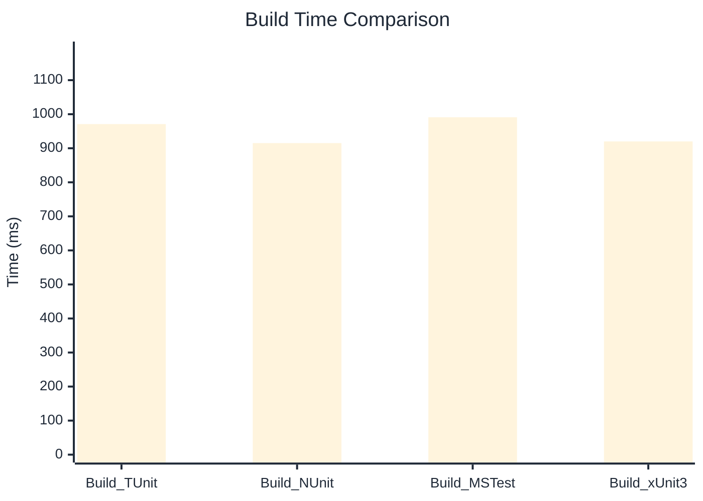

# Build Performance Benchmark

> Compilation time from a clean build across frameworks — how long it takes to build an identical test project.

:::info Last Updated
This benchmark was automatically generated on **2026-11-08** from the latest CI run.

**Environment:** Ubuntu Latest • .NET SDK 10.0.403
:::

## 📊 Results

Compilation time comparison across frameworks:

| Framework | Version | Mean | Median | StdDev |
|-----------|---------|------|--------|--------|
| **TUnit** | 1.81.10 | 971.0 ms | 951.5 ms | 57.17 ms |
| Build_NUnit | 5.0.0 | 915.2 ms | 913.8 ms | 14.34 ms |
| Build_MSTest | 4.5.2 | 991.0 ms | 989.1 ms | 11.85 ms |
| Build_xUnit3 | 4.0.2 | 920.1 ms | 920.7 ms | 17.26 ms |

## 📈 Visual Comparison

---

:::note Methodology
View the [benchmarks overview](/docs/benchmarks) for methodology details and environment information.
:::

*Last generated: 2026-11-08T00:25:14.106Z*
