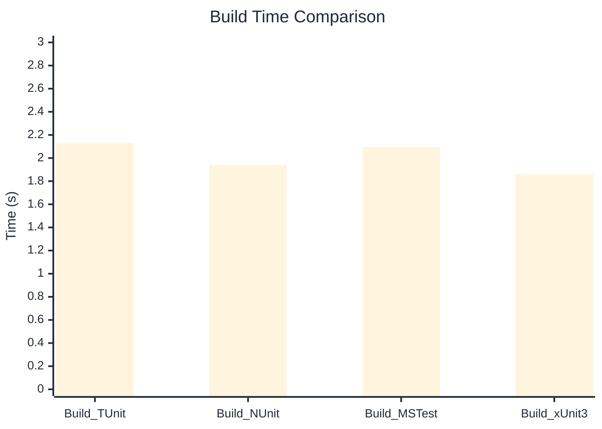

# Build Performance Benchmark

> Compilation time from a clean build across frameworks — how long it takes to build an identical test project.

:::info Last Updated
This benchmark was automatically generated on **2026-11-15** from the latest CI run.

**Environment:** Ubuntu Latest • .NET SDK 11.0.100
:::

## 📊 Results

Compilation time comparison across frameworks:

| Framework | Version | Mean | Median | StdDev |
|-----------|---------|------|--------|--------|
| **TUnit** | 1.85.0 | 2.130 s | 2.129 s | 0.0341 s |
| Build_NUnit | 5.0.0 | 1.939 s | 1.930 s | 0.0700 s |
| Build_MSTest | 4.5.3 | 2.096 s | 2.095 s | 0.0544 s |
| Build_xUnit3 | 4.0.3 | 1.861 s | 1.857 s | 0.0280 s |

## 📈 Visual Comparison

---

:::note Methodology
View the [benchmarks overview](/docs/benchmarks) for methodology details and environment information.
:::

*Last generated: 2026-11-15T00:25:34.724Z*
