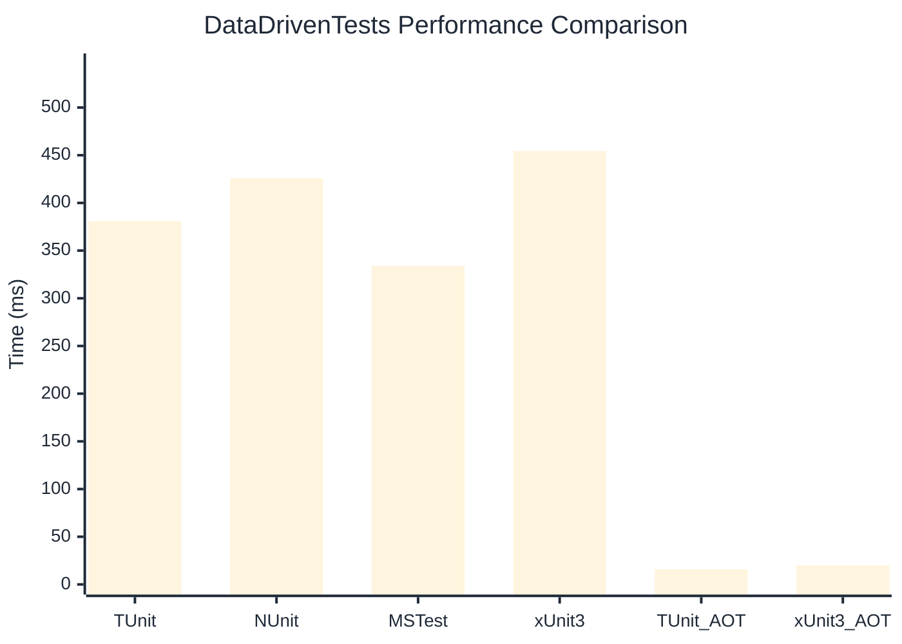

# DataDrivenTests Benchmark

> Parameterized tests with multiple data sources

:::info Last Updated
This benchmark was automatically generated on **2026-11-10** from the latest CI run.

**Environment:** Ubuntu Latest • .NET SDK 11.0.100
:::

## 📊 Results

| Framework | Version | Mean | Median | StdDev |
|-----------|---------|------|--------|--------|
| **TUnit** | 1.81.16 | 380.89 ms | 375.69 ms | 24.140 ms |
| NUnit | 5.0.0 | 425.77 ms | 428.07 ms | 39.681 ms |
| MSTest | 4.5.2 | 334.07 ms | 335.00 ms | 25.907 ms |
| xUnit3 | 4.0.3 | 454.53 ms | 444.39 ms | 32.338 ms |
| **TUnit (AOT)** | 1.81.16 | 15.92 ms | 15.98 ms | 0.447 ms |
| xUnit3_AOT | 4.0.3 | 20.09 ms | 20.09 ms | 0.144 ms |

## 📈 Visual Comparison

## 🎯 Key Insights

This benchmark compares TUnit's performance against NUnit, MSTest, xUnit3, xUnit3_AOT using identical test scenarios.

---

:::note Methodology
View the [benchmarks overview](/docs/benchmarks) for methodology details and environment information.
:::

*Last generated: 2026-11-10T20:21:13.646Z*
