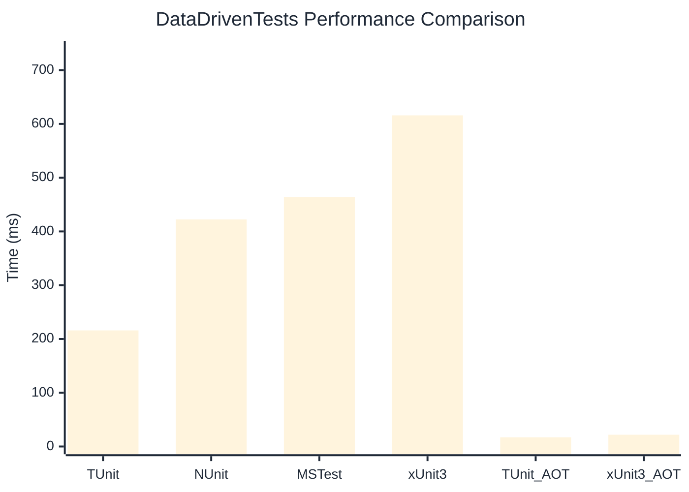

# DataDrivenTests Benchmark

> Parameterized tests with multiple data sources

:::info Last Updated
This benchmark was automatically generated on **2026-11-01** from the latest CI run.

**Environment:** Ubuntu Latest • .NET SDK 10.0.403
:::

## 📊 Results

| Framework | Version | Mean | Median | StdDev |
|-----------|---------|------|--------|--------|
| **TUnit** | 1.76.28 | 215.91 ms | 215.32 ms | 2.824 ms |
| NUnit | 5.0.0 | 422.34 ms | 420.53 ms | 5.573 ms |
| MSTest | 4.5.2 | 464.19 ms | 454.62 ms | 47.506 ms |
| xUnit3 | 4.0.2 | 615.90 ms | 616.37 ms | 65.368 ms |
| **TUnit (AOT)** | 1.76.28 | 16.94 ms | 16.64 ms | 3.318 ms |
| xUnit3_AOT | 4.0.2 | 21.91 ms | 21.65 ms | 2.266 ms |

## 📈 Visual Comparison

## 🎯 Key Insights

This benchmark compares TUnit's performance against NUnit, MSTest, xUnit3, xUnit3_AOT using identical test scenarios.

---

:::note Methodology
View the [benchmarks overview](/docs/benchmarks) for methodology details and environment information.
:::

*Last generated: 2026-11-01T00:31:22.050Z*
