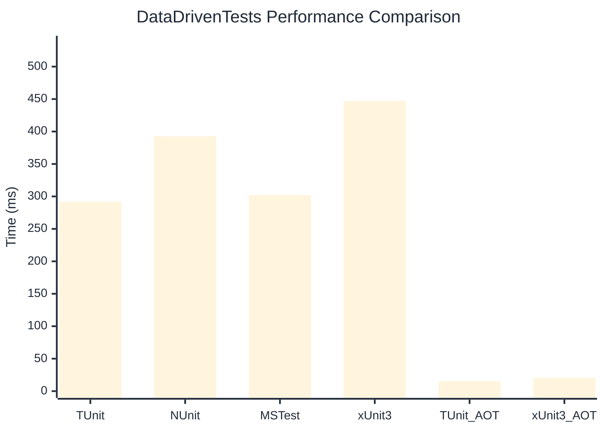

# DataDrivenTests Benchmark

> Parameterized tests with multiple data sources

:::info Last Updated
This benchmark was automatically generated on **2026-11-11** from the latest CI run.

**Environment:** Ubuntu Latest • .NET SDK 11.0.100
:::

## 📊 Results

| Framework | Version | Mean | Median | StdDev |
|-----------|---------|------|--------|--------|
| **TUnit** | 1.83.8 | 291.99 ms | 294.19 ms | 13.143 ms |
| NUnit | 5.0.0 | 392.71 ms | 389.48 ms | 34.431 ms |
| MSTest | 4.5.3 | 302.13 ms | 300.12 ms | 20.649 ms |
| xUnit3 | 4.0.3 | 447.19 ms | 448.05 ms | 29.294 ms |
| **TUnit (AOT)** | 1.83.8 | 15.33 ms | 15.27 ms | 0.863 ms |
| xUnit3_AOT | 4.0.3 | 20.67 ms | 20.75 ms | 0.797 ms |

## 📈 Visual Comparison

## 🎯 Key Insights

This benchmark compares TUnit's performance against NUnit, MSTest, xUnit3, xUnit3_AOT using identical test scenarios.

---

:::note Methodology
View the [benchmarks overview](/docs/benchmarks) for methodology details and environment information.
:::

*Last generated: 2026-11-11T22:02:50.439Z*
