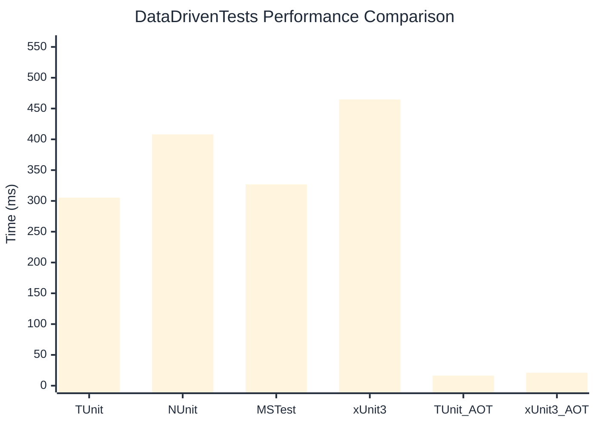

# DataDrivenTests Benchmark

> Parameterized tests with multiple data sources

:::info Last Updated
This benchmark was automatically generated on **2026-11-22** from the latest CI run.

**Environment:** Ubuntu Latest • .NET SDK 11.0.100
:::

## 📊 Results

| Framework | Version | Mean | Median | StdDev |
|-----------|---------|------|--------|--------|
| **TUnit** | 1.87.12 | 305.32 ms | 306.88 ms | 11.430 ms |
| NUnit | 5.0.0 | 408.01 ms | 407.44 ms | 32.209 ms |
| MSTest | 4.5.3 | 326.90 ms | 326.30 ms | 30.910 ms |
| xUnit3 | 4.0.3 | 464.63 ms | 464.42 ms | 23.275 ms |
| **TUnit (AOT)** | 1.87.12 | 16.43 ms | 16.47 ms | 0.394 ms |
| xUnit3_AOT | 4.0.3 | 21.11 ms | 21.06 ms | 0.210 ms |

## 📈 Visual Comparison

## 🎯 Key Insights

This benchmark compares TUnit's performance against NUnit, MSTest, xUnit3, xUnit3_AOT using identical test scenarios.

---

:::note Methodology
View the [benchmarks overview](/docs/benchmarks) for methodology details and environment information.
:::

*Last generated: 2026-11-22T00:26:14.012Z*
