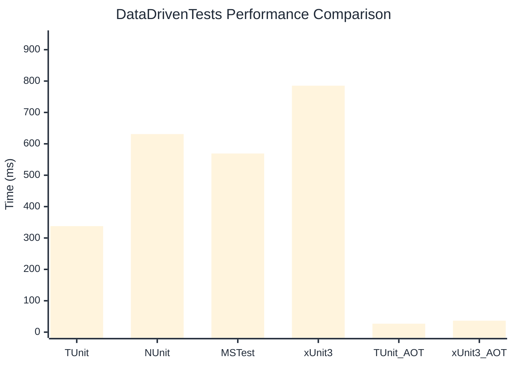

# DataDrivenTests Benchmark

> Parameterized tests with multiple data sources

:::info Last Updated
This benchmark was automatically generated on **2026-10-18** from the latest CI run.

**Environment:** Ubuntu Latest • .NET SDK 10.0.402
:::

## 📊 Results

| Framework | Version | Mean | Median | StdDev |
|-----------|---------|------|--------|--------|
| **TUnit** | 1.75.0 | 337.87 ms | 334.11 ms | 12.601 ms |
| NUnit | 5.0.0 | 631.09 ms | 631.41 ms | 12.761 ms |
| MSTest | 4.5.1 | 569.21 ms | 568.82 ms | 10.639 ms |
| xUnit3 | 4.0.2 | 785.28 ms | 761.10 ms | 87.107 ms |
| **TUnit (AOT)** | 1.75.0 | 26.94 ms | 26.74 ms | 4.208 ms |
| xUnit3_AOT | 4.0.2 | 36.52 ms | 36.54 ms | 2.925 ms |

## 📈 Visual Comparison

## 🎯 Key Insights

This benchmark compares TUnit's performance against NUnit, MSTest, xUnit3, xUnit3_AOT using identical test scenarios.

---

:::note Methodology
View the [benchmarks overview](/docs/benchmarks) for methodology details and environment information.
:::

*Last generated: 2026-10-18T00:34:22.692Z*
