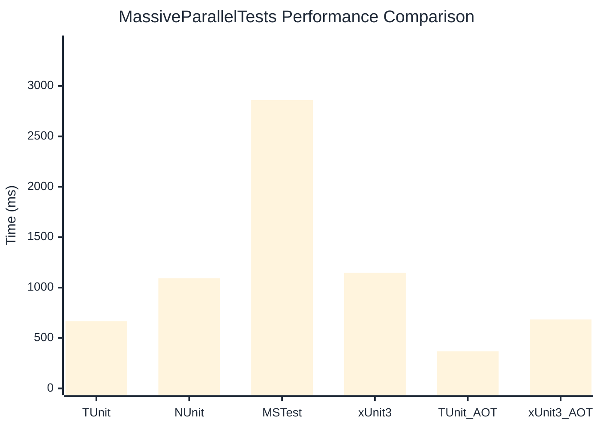

# MassiveParallelTests Benchmark

> Parallel execution stress tests

:::info Last Updated
This benchmark was automatically generated on **2026-11-22** from the latest CI run.

**Environment:** Ubuntu Latest • .NET SDK 11.0.100
:::

## 📊 Results

| Framework | Version | Mean | Median | StdDev |
|-----------|---------|------|--------|--------|
| **TUnit** | 1.87.12 | 667.5 ms | 662.0 ms | 23.98 ms |
| NUnit | 5.0.0 | 1,092.2 ms | 1,090.7 ms | 37.38 ms |
| MSTest | 4.5.3 | 2,860.7 ms | 2,862.4 ms | 51.12 ms |
| xUnit3 | 4.0.3 | 1,146.0 ms | 1,149.8 ms | 40.03 ms |
| **TUnit (AOT)** | 1.87.12 | 367.1 ms | 366.3 ms | 2.24 ms |
| xUnit3_AOT | 4.0.3 | 683.9 ms | 684.8 ms | 7.07 ms |

## 📈 Visual Comparison

## 🎯 Key Insights

This benchmark compares TUnit's performance against NUnit, MSTest, xUnit3, xUnit3_AOT using identical test scenarios.

---

:::note Methodology
View the [benchmarks overview](/docs/benchmarks) for methodology details and environment information.
:::

*Last generated: 2026-11-22T00:26:14.012Z*
