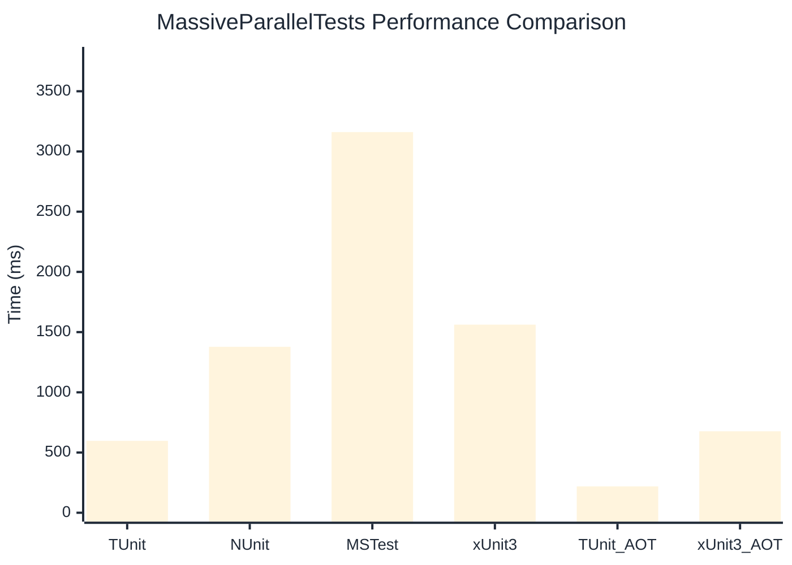

# MassiveParallelTests Benchmark

> Parallel execution stress tests

:::info Last Updated
This benchmark was automatically generated on **2026-10-25** from the latest CI run.

**Environment:** Ubuntu Latest • .NET SDK 10.0.402
:::

## 📊 Results

| Framework | Version | Mean | Median | StdDev |
|-----------|---------|------|--------|--------|
| **TUnit** | 1.76.0 | 597.0 ms | 589.9 ms | 63.91 ms |
| NUnit | 5.0.0 | 1,378.1 ms | 1,347.8 ms | 104.81 ms |
| MSTest | 4.5.1 | 3,161.0 ms | 3,163.9 ms | 52.02 ms |
| xUnit3 | 4.0.2 | 1,561.9 ms | 1,540.1 ms | 132.81 ms |
| **TUnit (AOT)** | 1.76.0 | 218.9 ms | 218.2 ms | 2.13 ms |
| xUnit3_AOT | 4.0.2 | 676.5 ms | 672.9 ms | 6.49 ms |

## 📈 Visual Comparison

## 🎯 Key Insights

This benchmark compares TUnit's performance against NUnit, MSTest, xUnit3, xUnit3_AOT using identical test scenarios.

---

:::note Methodology
View the [benchmarks overview](/docs/benchmarks) for methodology details and environment information.
:::

*Last generated: 2026-10-25T00:37:19.570Z*
