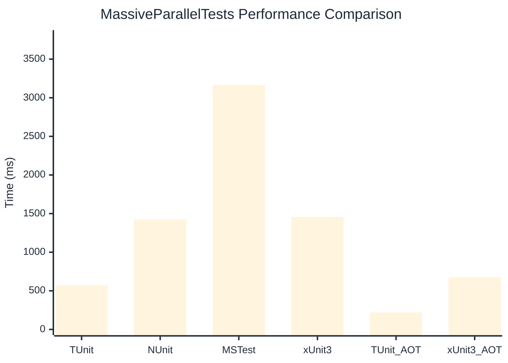

# MassiveParallelTests Benchmark

> Parallel execution stress tests

:::info Last Updated
This benchmark was automatically generated on **2026-11-01** from the latest CI run.

**Environment:** Ubuntu Latest • .NET SDK 10.0.403
:::

## 📊 Results

| Framework | Version | Mean | Median | StdDev |
|-----------|---------|------|--------|--------|
| **TUnit** | 1.76.28 | 571.1 ms | 573.7 ms | 24.75 ms |
| NUnit | 5.0.0 | 1,424.4 ms | 1,389.6 ms | 116.71 ms |
| MSTest | 4.5.2 | 3,167.1 ms | 3,157.9 ms | 111.62 ms |
| xUnit3 | 4.0.2 | 1,457.9 ms | 1,453.4 ms | 70.95 ms |
| **TUnit (AOT)** | 1.76.28 | 219.4 ms | 219.2 ms | 2.86 ms |
| xUnit3_AOT | 4.0.2 | 674.3 ms | 673.8 ms | 1.80 ms |

## 📈 Visual Comparison

## 🎯 Key Insights

This benchmark compares TUnit's performance against NUnit, MSTest, xUnit3, xUnit3_AOT using identical test scenarios.

---

:::note Methodology
View the [benchmarks overview](/docs/benchmarks) for methodology details and environment information.
:::

*Last generated: 2026-11-01T00:31:22.050Z*
