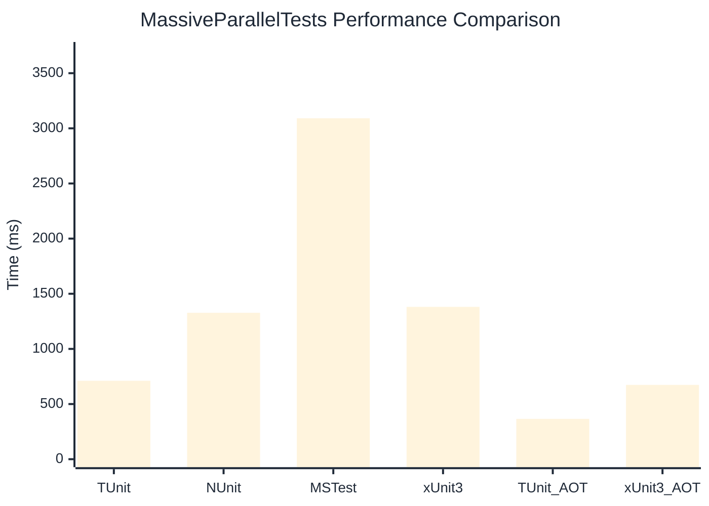

# MassiveParallelTests Benchmark

> Parallel execution stress tests

:::info Last Updated
This benchmark was automatically generated on **2026-11-10** from the latest CI run.

**Environment:** Ubuntu Latest • .NET SDK 11.0.100
:::

## 📊 Results

| Framework | Version | Mean | Median | StdDev |
|-----------|---------|------|--------|--------|
| **TUnit** | 1.81.16 | 711.1 ms | 706.2 ms | 16.43 ms |
| NUnit | 5.0.0 | 1,327.5 ms | 1,325.6 ms | 42.37 ms |
| MSTest | 4.5.2 | 3,091.3 ms | 3,088.2 ms | 26.12 ms |
| xUnit3 | 4.0.3 | 1,381.2 ms | 1,377.9 ms | 36.71 ms |
| **TUnit (AOT)** | 1.81.16 | 365.7 ms | 365.0 ms | 2.07 ms |
| xUnit3_AOT | 4.0.3 | 673.6 ms | 672.3 ms | 3.84 ms |

## 📈 Visual Comparison

## 🎯 Key Insights

This benchmark compares TUnit's performance against NUnit, MSTest, xUnit3, xUnit3_AOT using identical test scenarios.

---

:::note Methodology
View the [benchmarks overview](/docs/benchmarks) for methodology details and environment information.
:::

*Last generated: 2026-11-10T19:30:56.051Z*
