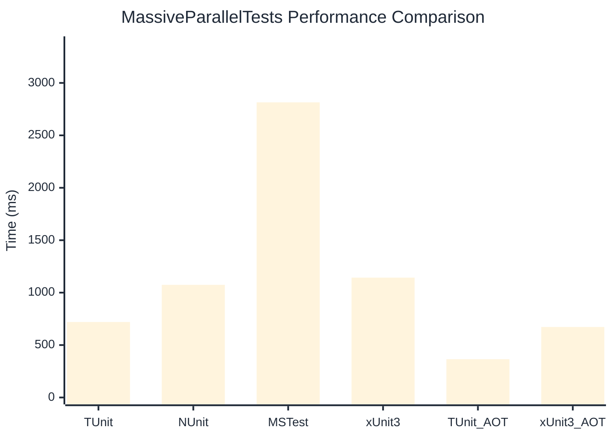

# MassiveParallelTests Benchmark

> Parallel execution stress tests

:::info Last Updated
This benchmark was automatically generated on **2026-11-11** from the latest CI run.

**Environment:** Ubuntu Latest • .NET SDK 11.0.100
:::

## 📊 Results

| Framework | Version | Mean | Median | StdDev |
|-----------|---------|------|--------|--------|
| **TUnit** | 1.83.0 | 719.7 ms | 717.6 ms | 24.56 ms |
| NUnit | 5.0.0 | 1,074.5 ms | 1,075.7 ms | 20.19 ms |
| MSTest | 4.5.3 | 2,814.9 ms | 2,809.7 ms | 28.85 ms |
| xUnit3 | 4.0.3 | 1,143.4 ms | 1,147.1 ms | 34.04 ms |
| **TUnit (AOT)** | 1.83.0 | 365.1 ms | 364.8 ms | 1.10 ms |
| xUnit3_AOT | 4.0.3 | 672.6 ms | 672.3 ms | 1.52 ms |

## 📈 Visual Comparison

## 🎯 Key Insights

This benchmark compares TUnit's performance against NUnit, MSTest, xUnit3, xUnit3_AOT using identical test scenarios.

---

:::note Methodology
View the [benchmarks overview](/docs/benchmarks) for methodology details and environment information.
:::

*Last generated: 2026-11-11T19:48:26.572Z*
