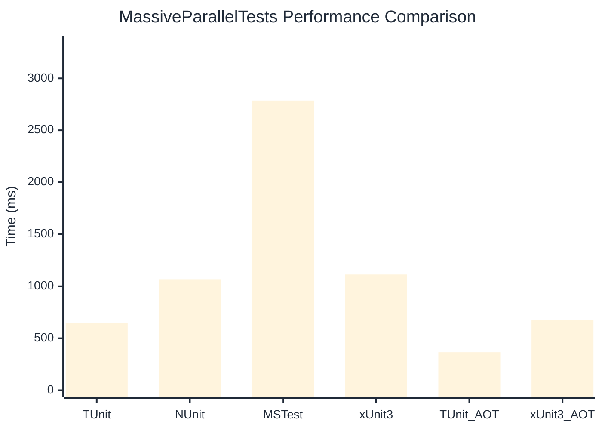

# MassiveParallelTests Benchmark

> Parallel execution stress tests

:::info Last Updated
This benchmark was automatically generated on **2026-11-12** from the latest CI run.

**Environment:** Ubuntu Latest • .NET SDK 11.0.100
:::

## 📊 Results

| Framework | Version | Mean | Median | StdDev |
|-----------|---------|------|--------|--------|
| **TUnit** | 1.84.0 | 646.9 ms | 652.9 ms | 16.25 ms |
| NUnit | 5.0.0 | 1,063.4 ms | 1,072.1 ms | 28.72 ms |
| MSTest | 4.5.3 | 2,786.7 ms | 2,782.9 ms | 21.37 ms |
| xUnit3 | 4.0.3 | 1,113.7 ms | 1,102.9 ms | 35.99 ms |
| **TUnit (AOT)** | 1.84.0 | 365.4 ms | 365.4 ms | 1.87 ms |
| xUnit3_AOT | 4.0.3 | 675.1 ms | 675.6 ms | 3.02 ms |

## 📈 Visual Comparison

## 🎯 Key Insights

This benchmark compares TUnit's performance against NUnit, MSTest, xUnit3, xUnit3_AOT using identical test scenarios.

---

:::note Methodology
View the [benchmarks overview](/docs/benchmarks) for methodology details and environment information.
:::

*Last generated: 2026-11-12T22:35:43.065Z*
