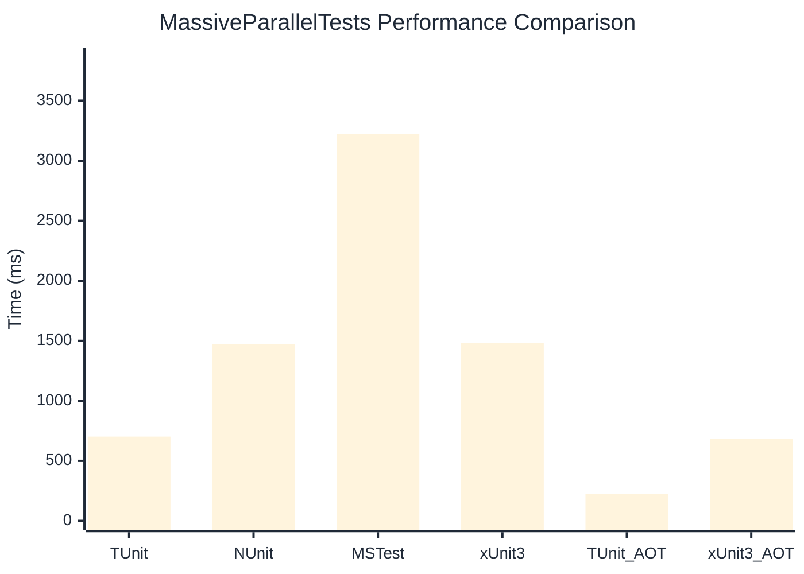

# MassiveParallelTests Benchmark

> Parallel execution stress tests

:::info Last Updated
This benchmark was automatically generated on **2026-10-18** from the latest CI run.

**Environment:** Ubuntu Latest • .NET SDK 10.0.402
:::

## 📊 Results

| Framework | Version | Mean | Median | StdDev |
|-----------|---------|------|--------|--------|
| **TUnit** | 1.75.0 | 702.2 ms | 708.1 ms | 82.62 ms |
| NUnit | 5.0.0 | 1,473.2 ms | 1,471.9 ms | 71.62 ms |
| MSTest | 4.5.1 | 3,221.1 ms | 3,229.7 ms | 56.33 ms |
| xUnit3 | 4.0.2 | 1,481.3 ms | 1,494.9 ms | 69.27 ms |
| **TUnit (AOT)** | 1.75.0 | 226.0 ms | 225.8 ms | 2.33 ms |
| xUnit3_AOT | 4.0.2 | 685.6 ms | 682.6 ms | 8.48 ms |

## 📈 Visual Comparison

## 🎯 Key Insights

This benchmark compares TUnit's performance against NUnit, MSTest, xUnit3, xUnit3_AOT using identical test scenarios.

---

:::note Methodology
View the [benchmarks overview](/docs/benchmarks) for methodology details and environment information.
:::

*Last generated: 2026-10-18T00:34:22.692Z*
