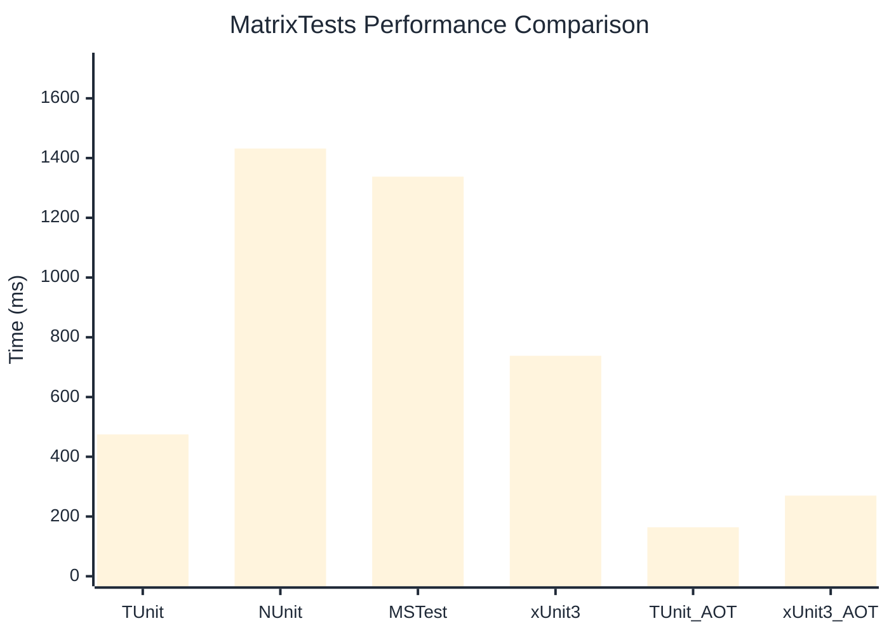

# MatrixTests Benchmark

> Combinatorial test generation and execution

:::info Last Updated
This benchmark was automatically generated on **2026-11-22** from the latest CI run.

**Environment:** Ubuntu Latest • .NET SDK 11.0.100
:::

## 📊 Results

| Framework | Version | Mean | Median | StdDev |
|-----------|---------|------|--------|--------|
| **TUnit** | 1.87.12 | 474.8 ms | 474.6 ms | 26.66 ms |
| NUnit | 5.0.0 | 1,432.0 ms | 1,432.7 ms | 33.84 ms |
| MSTest | 4.5.3 | 1,337.8 ms | 1,340.0 ms | 22.96 ms |
| xUnit3 | 4.0.3 | 738.0 ms | 734.9 ms | 26.40 ms |
| **TUnit (AOT)** | 1.87.12 | 164.0 ms | 163.3 ms | 1.77 ms |
| xUnit3_AOT | 4.0.3 | 270.0 ms | 268.8 ms | 2.61 ms |

## 📈 Visual Comparison

## 🎯 Key Insights

This benchmark compares TUnit's performance against NUnit, MSTest, xUnit3, xUnit3_AOT using identical test scenarios.

---

:::note Methodology
View the [benchmarks overview](/docs/benchmarks) for methodology details and environment information.
:::

*Last generated: 2026-11-22T00:26:14.012Z*
