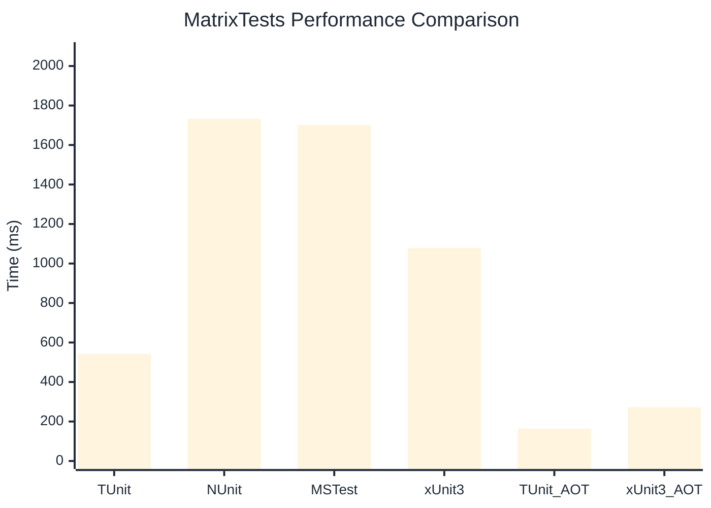

# MatrixTests Benchmark

> Combinatorial test generation and execution

:::info Last Updated
This benchmark was automatically generated on **2026-11-10** from the latest CI run.

**Environment:** Ubuntu Latest • .NET SDK 11.0.100
:::

## 📊 Results

| Framework | Version | Mean | Median | StdDev |
|-----------|---------|------|--------|--------|
| **TUnit** | 1.81.16 | 541.9 ms | 537.1 ms | 34.15 ms |
| NUnit | 5.0.0 | 1,732.9 ms | 1,717.7 ms | 80.29 ms |
| MSTest | 4.5.2 | 1,702.1 ms | 1,689.9 ms | 54.83 ms |
| xUnit3 | 4.0.3 | 1,078.1 ms | 1,071.7 ms | 54.13 ms |
| **TUnit (AOT)** | 1.81.16 | 164.5 ms | 164.2 ms | 0.76 ms |
| xUnit3_AOT | 4.0.3 | 272.2 ms | 272.6 ms | 3.37 ms |

## 📈 Visual Comparison

## 🎯 Key Insights

This benchmark compares TUnit's performance against NUnit, MSTest, xUnit3, xUnit3_AOT using identical test scenarios.

---

:::note Methodology
View the [benchmarks overview](/docs/benchmarks) for methodology details and environment information.
:::

*Last generated: 2026-11-10T19:30:56.051Z*
