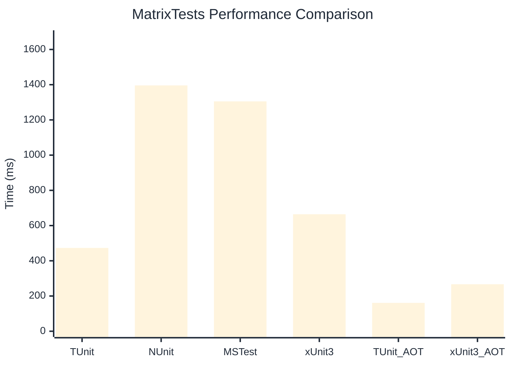

# MatrixTests Benchmark

> Combinatorial test generation and execution

:::info Last Updated
This benchmark was automatically generated on **2026-11-11** from the latest CI run.

**Environment:** Ubuntu Latest • .NET SDK 11.0.100
:::

## 📊 Results

| Framework | Version | Mean | Median | StdDev |
|-----------|---------|------|--------|--------|
| **TUnit** | 1.83.0 | 473.0 ms | 469.7 ms | 15.83 ms |
| NUnit | 5.0.0 | 1,395.9 ms | 1,388.8 ms | 31.85 ms |
| MSTest | 4.5.2 | 1,305.3 ms | 1,293.2 ms | 28.89 ms |
| xUnit3 | 4.0.3 | 664.3 ms | 657.7 ms | 21.94 ms |
| **TUnit (AOT)** | 1.83.0 | 161.1 ms | 161.0 ms | 0.33 ms |
| xUnit3_AOT | 4.0.3 | 266.9 ms | 267.0 ms | 0.72 ms |

## 📈 Visual Comparison

## 🎯 Key Insights

This benchmark compares TUnit's performance against NUnit, MSTest, xUnit3, xUnit3_AOT using identical test scenarios.

---

:::note Methodology
View the [benchmarks overview](/docs/benchmarks) for methodology details and environment information.
:::

*Last generated: 2026-11-11T00:47:49.900Z*
