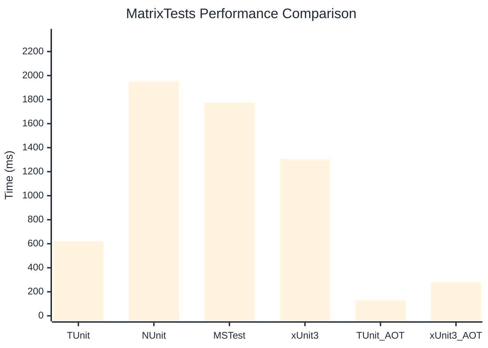

# MatrixTests Benchmark

> Combinatorial test generation and execution

:::info Last Updated
This benchmark was automatically generated on **2026-11-01** from the latest CI run.

**Environment:** Ubuntu Latest • .NET SDK 10.0.403
:::

## 📊 Results

| Framework | Version | Mean | Median | StdDev |
|-----------|---------|------|--------|--------|
| **TUnit** | 1.76.28 | 619.3 ms | 624.0 ms | 99.75 ms |
| NUnit | 5.0.0 | 1,951.7 ms | 1,962.7 ms | 100.34 ms |
| MSTest | 4.5.2 | 1,774.3 ms | 1,757.0 ms | 105.68 ms |
| xUnit3 | 4.0.2 | 1,305.9 ms | 1,315.2 ms | 158.22 ms |
| **TUnit (AOT)** | 1.76.28 | 129.6 ms | 129.9 ms | 3.79 ms |
| xUnit3_AOT | 4.0.2 | 280.1 ms | 280.5 ms | 3.70 ms |

## 📈 Visual Comparison

## 🎯 Key Insights

This benchmark compares TUnit's performance against NUnit, MSTest, xUnit3, xUnit3_AOT using identical test scenarios.

---

:::note Methodology
View the [benchmarks overview](/docs/benchmarks) for methodology details and environment information.
:::

*Last generated: 2026-11-01T00:31:22.050Z*
