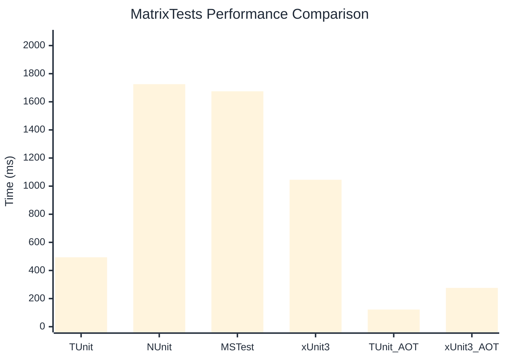

# MatrixTests Benchmark

> Combinatorial test generation and execution

:::info Last Updated
This benchmark was automatically generated on **2026-10-18** from the latest CI run.

**Environment:** Ubuntu Latest • .NET SDK 10.0.402
:::

## 📊 Results

| Framework | Version | Mean | Median | StdDev |
|-----------|---------|------|--------|--------|
| **TUnit** | 1.75.0 | 493.9 ms | 479.7 ms | 49.82 ms |
| NUnit | 5.0.0 | 1,725.5 ms | 1,718.9 ms | 34.66 ms |
| MSTest | 4.5.1 | 1,674.7 ms | 1,674.5 ms | 28.07 ms |
| xUnit3 | 4.0.2 | 1,045.4 ms | 1,043.2 ms | 35.73 ms |
| **TUnit (AOT)** | 1.75.0 | 122.2 ms | 121.4 ms | 2.42 ms |
| xUnit3_AOT | 4.0.2 | 276.1 ms | 275.1 ms | 2.02 ms |

## 📈 Visual Comparison

## 🎯 Key Insights

This benchmark compares TUnit's performance against NUnit, MSTest, xUnit3, xUnit3_AOT using identical test scenarios.

---

:::note Methodology
View the [benchmarks overview](/docs/benchmarks) for methodology details and environment information.
:::

*Last generated: 2026-10-18T00:34:22.693Z*
