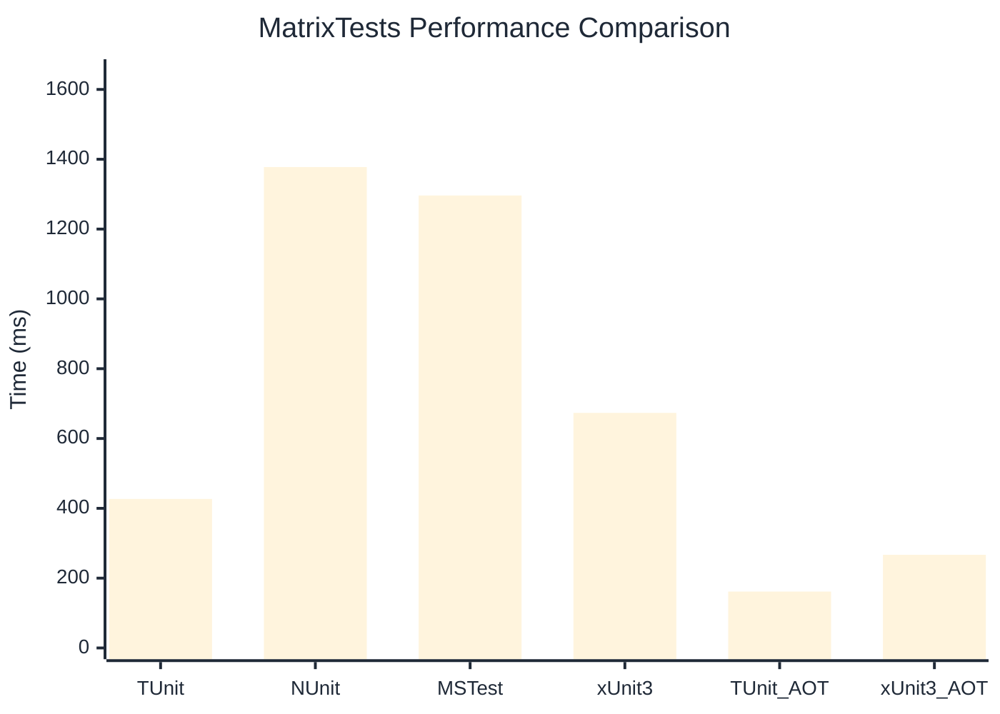

# MatrixTests Benchmark

> Combinatorial test generation and execution

:::info Last Updated
This benchmark was automatically generated on **2026-11-12** from the latest CI run.

**Environment:** Ubuntu Latest • .NET SDK 11.0.100
:::

## 📊 Results

| Framework | Version | Mean | Median | StdDev |
|-----------|---------|------|--------|--------|
| **TUnit** | 1.84.0 | 426.9 ms | 433.7 ms | 17.05 ms |
| NUnit | 5.0.0 | 1,377.7 ms | 1,363.5 ms | 25.20 ms |
| MSTest | 4.5.3 | 1,296.2 ms | 1,290.6 ms | 19.30 ms |
| xUnit3 | 4.0.3 | 673.4 ms | 668.4 ms | 27.37 ms |
| **TUnit (AOT)** | 1.84.0 | 161.5 ms | 161.3 ms | 0.56 ms |
| xUnit3_AOT | 4.0.3 | 266.9 ms | 266.6 ms | 0.72 ms |

## 📈 Visual Comparison

## 🎯 Key Insights

This benchmark compares TUnit's performance against NUnit, MSTest, xUnit3, xUnit3_AOT using identical test scenarios.

---

:::note Methodology
View the [benchmarks overview](/docs/benchmarks) for methodology details and environment information.
:::

*Last generated: 2026-11-12T22:35:43.065Z*
