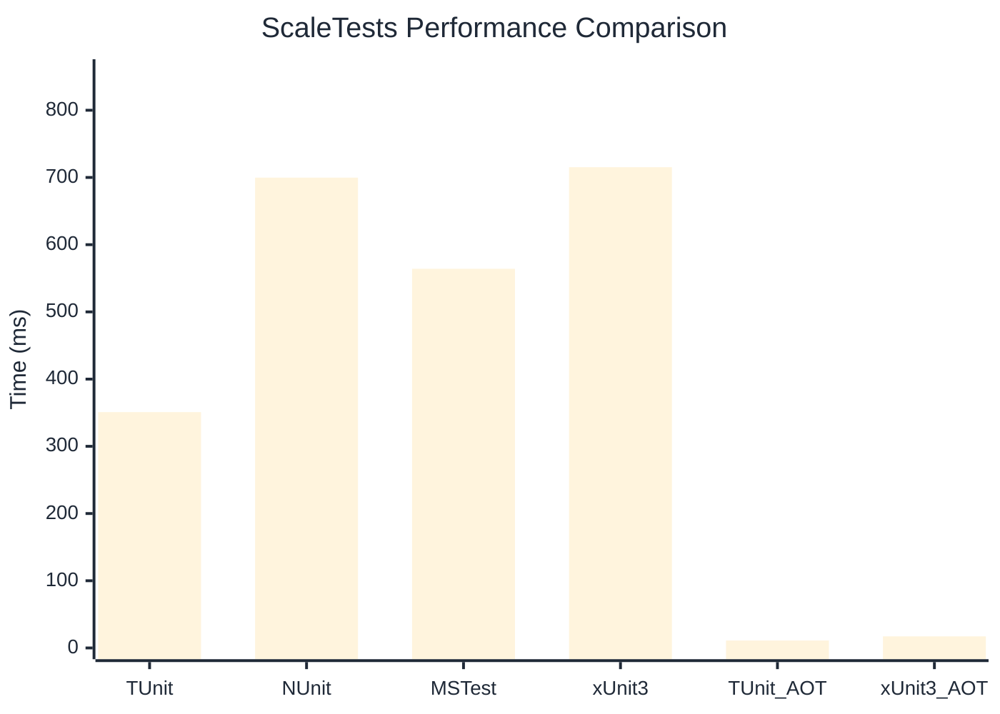

# ScaleTests Benchmark

> Large test suites (150+ tests) measuring scalability

:::info Last Updated
This benchmark was automatically generated on **2026-11-10** from the latest CI run.

**Environment:** Ubuntu Latest • .NET SDK 11.0.100
:::

## 📊 Results

| Framework | Version | Mean | Median | StdDev |
|-----------|---------|------|--------|--------|
| **TUnit** | 1.81.16 | 350.88 ms | 344.80 ms | 24.004 ms |
| NUnit | 5.0.0 | 699.73 ms | 695.19 ms | 37.111 ms |
| MSTest | 4.5.2 | 564.12 ms | 562.38 ms | 25.530 ms |
| xUnit3 | 4.0.3 | 715.25 ms | 704.99 ms | 40.990 ms |
| **TUnit (AOT)** | 1.81.16 | 11.08 ms | 11.06 ms | 0.205 ms |
| xUnit3_AOT | 4.0.3 | 17.26 ms | 17.22 ms | 0.569 ms |

## 📈 Visual Comparison

## 🎯 Key Insights

This benchmark compares TUnit's performance against NUnit, MSTest, xUnit3, xUnit3_AOT using identical test scenarios.

---

:::note Methodology
View the [benchmarks overview](/docs/benchmarks) for methodology details and environment information.
:::

*Last generated: 2026-11-10T19:30:56.052Z*
