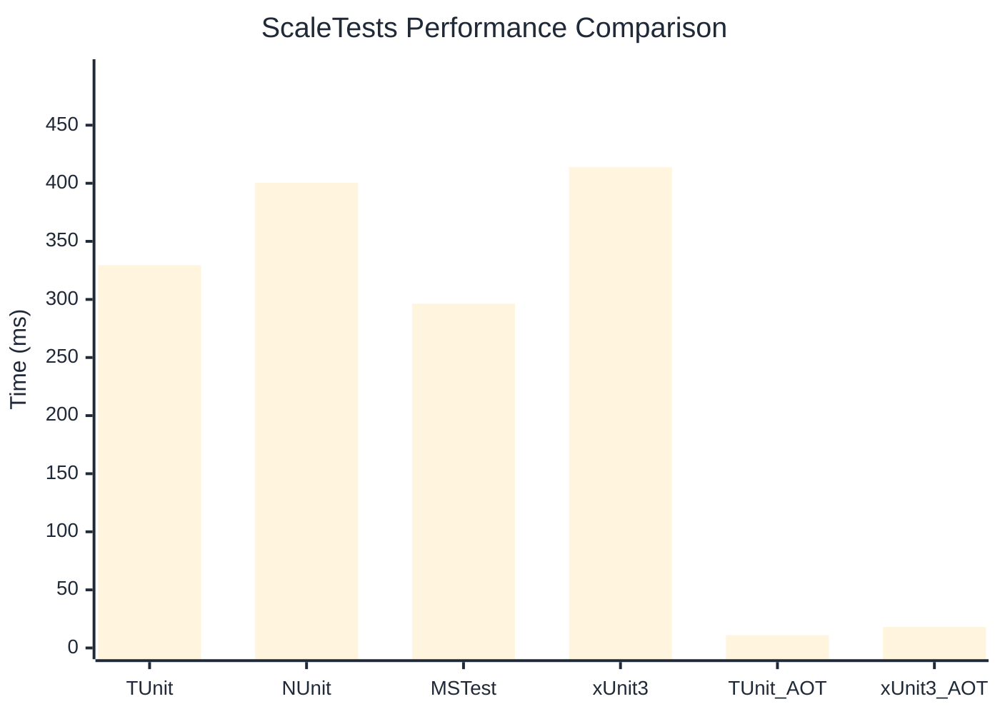

# ScaleTests Benchmark

> Large test suites (150+ tests) measuring scalability

:::info Last Updated
This benchmark was automatically generated on **2026-11-11** from the latest CI run.

**Environment:** Ubuntu Latest • .NET SDK 11.0.100
:::

## 📊 Results

| Framework | Version | Mean | Median | StdDev |
|-----------|---------|------|--------|--------|
| **TUnit** | 1.83.0 | 329.54 ms | 328.09 ms | 14.076 ms |
| NUnit | 5.0.0 | 400.36 ms | 392.50 ms | 23.951 ms |
| MSTest | 4.5.3 | 296.34 ms | 297.69 ms | 15.711 ms |
| xUnit3 | 4.0.3 | 413.81 ms | 411.42 ms | 15.920 ms |
| **TUnit (AOT)** | 1.83.0 | 10.97 ms | 10.99 ms | 0.185 ms |
| xUnit3_AOT | 4.0.3 | 18.06 ms | 17.98 ms | 0.549 ms |

## 📈 Visual Comparison

## 🎯 Key Insights

This benchmark compares TUnit's performance against NUnit, MSTest, xUnit3, xUnit3_AOT using identical test scenarios.

---

:::note Methodology
View the [benchmarks overview](/docs/benchmarks) for methodology details and environment information.
:::

*Last generated: 2026-11-11T19:48:26.573Z*
