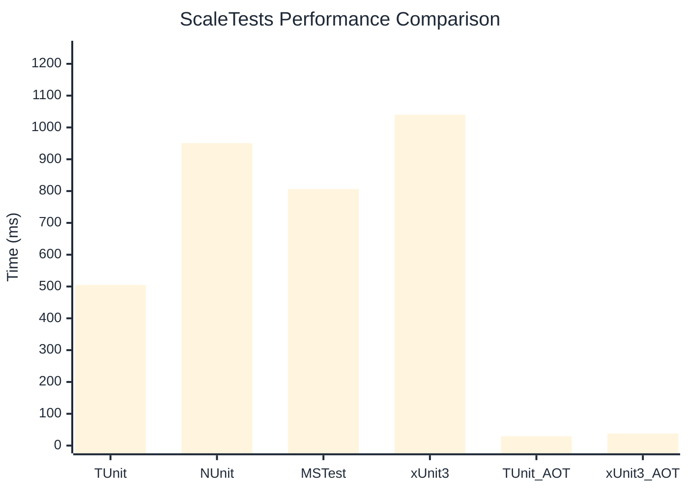

# ScaleTests Benchmark

> Large test suites (150+ tests) measuring scalability

:::info Last Updated
This benchmark was automatically generated on **2026-11-01** from the latest CI run.

**Environment:** Ubuntu Latest • .NET SDK 10.0.403
:::

## 📊 Results

| Framework | Version | Mean | Median | StdDev |
|-----------|---------|------|--------|--------|
| **TUnit** | 1.76.28 | 504.60 ms | 520.67 ms | 86.271 ms |
| NUnit | 5.0.0 | 950.59 ms | 940.64 ms | 78.948 ms |
| MSTest | 4.5.2 | 806.55 ms | 801.06 ms | 65.489 ms |
| xUnit3 | 4.0.2 | 1,039.88 ms | 1,032.47 ms | 85.115 ms |
| **TUnit (AOT)** | 1.76.28 | 29.11 ms | 28.93 ms | 2.298 ms |
| xUnit3_AOT | 4.0.2 | 37.88 ms | 37.83 ms | 2.676 ms |

## 📈 Visual Comparison

## 🎯 Key Insights

This benchmark compares TUnit's performance against NUnit, MSTest, xUnit3, xUnit3_AOT using identical test scenarios.

---

:::note Methodology
View the [benchmarks overview](/docs/benchmarks) for methodology details and environment information.
:::

*Last generated: 2026-11-01T00:31:22.050Z*
