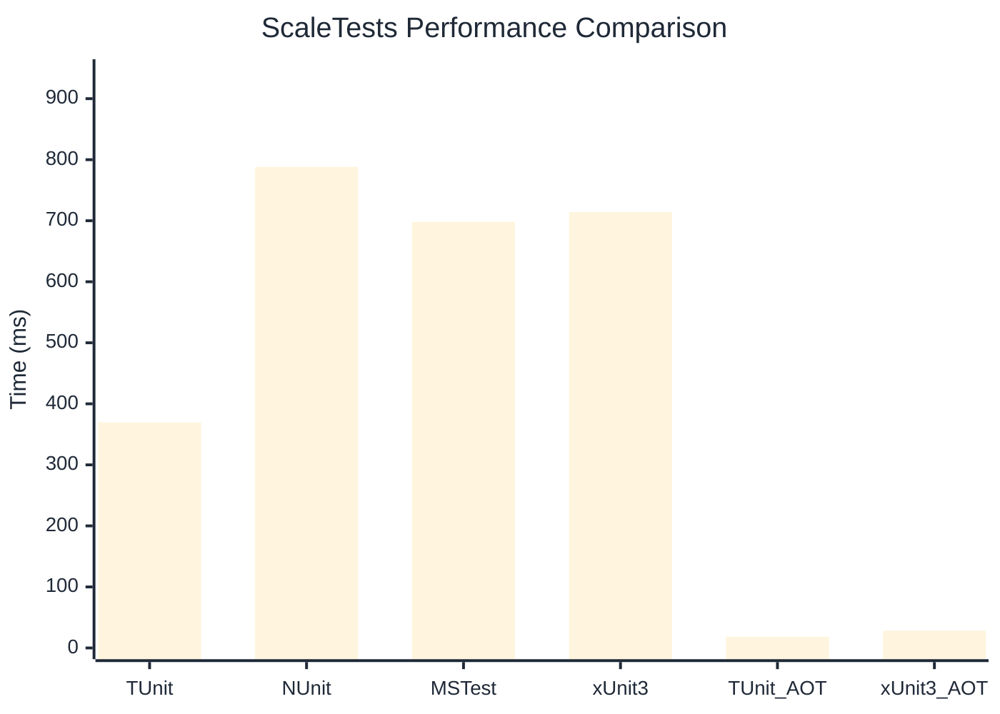

# ScaleTests Benchmark

> Large test suites (150+ tests) measuring scalability

:::info Last Updated
This benchmark was automatically generated on **2026-10-25** from the latest CI run.

**Environment:** Ubuntu Latest • .NET SDK 10.0.402
:::

## 📊 Results

| Framework | Version | Mean | Median | StdDev |
|-----------|---------|------|--------|--------|
| **TUnit** | 1.76.0 | 369.78 ms | 361.46 ms | 51.314 ms |
| NUnit | 5.0.0 | 788.16 ms | 780.35 ms | 64.480 ms |
| MSTest | 4.5.1 | 698.07 ms | 675.90 ms | 88.107 ms |
| xUnit3 | 4.0.2 | 714.12 ms | 715.48 ms | 29.244 ms |
| **TUnit (AOT)** | 1.76.0 | 18.38 ms | 18.23 ms | 0.812 ms |
| xUnit3_AOT | 4.0.2 | 28.28 ms | 27.98 ms | 3.443 ms |

## 📈 Visual Comparison

## 🎯 Key Insights

This benchmark compares TUnit's performance against NUnit, MSTest, xUnit3, xUnit3_AOT using identical test scenarios.

---

:::note Methodology
View the [benchmarks overview](/docs/benchmarks) for methodology details and environment information.
:::

*Last generated: 2026-10-25T00:37:19.571Z*
