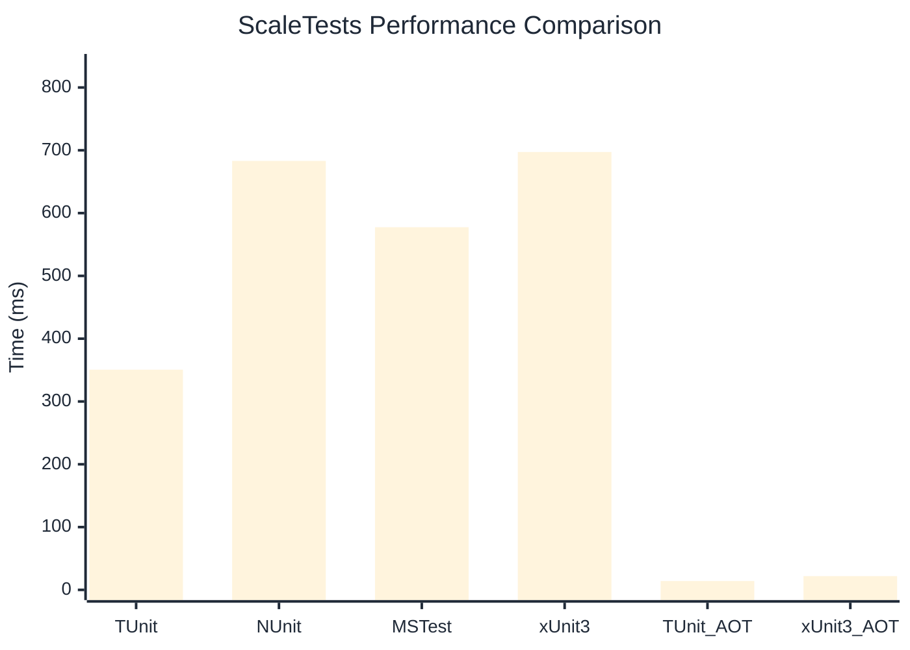

# ScaleTests Benchmark

> Large test suites (150+ tests) measuring scalability

:::info Last Updated
This benchmark was automatically generated on **2026-11-08** from the latest CI run.

**Environment:** Ubuntu Latest • .NET SDK 10.0.403
:::

## 📊 Results

| Framework | Version | Mean | Median | StdDev |
|-----------|---------|------|--------|--------|
| **TUnit** | 1.81.10 | 350.66 ms | 349.36 ms | 13.425 ms |
| NUnit | 5.0.0 | 683.12 ms | 678.72 ms | 22.495 ms |
| MSTest | 4.5.2 | 577.51 ms | 577.72 ms | 13.517 ms |
| xUnit3 | 4.0.2 | 697.29 ms | 691.19 ms | 17.050 ms |
| **TUnit (AOT)** | 1.81.10 | 14.14 ms | 13.99 ms | 1.032 ms |
| xUnit3_AOT | 4.0.2 | 21.91 ms | 21.99 ms | 0.258 ms |

## 📈 Visual Comparison

## 🎯 Key Insights

This benchmark compares TUnit's performance against NUnit, MSTest, xUnit3, xUnit3_AOT using identical test scenarios.

---

:::note Methodology
View the [benchmarks overview](/docs/benchmarks) for methodology details and environment information.
:::

*Last generated: 2026-11-08T00:25:14.106Z*
