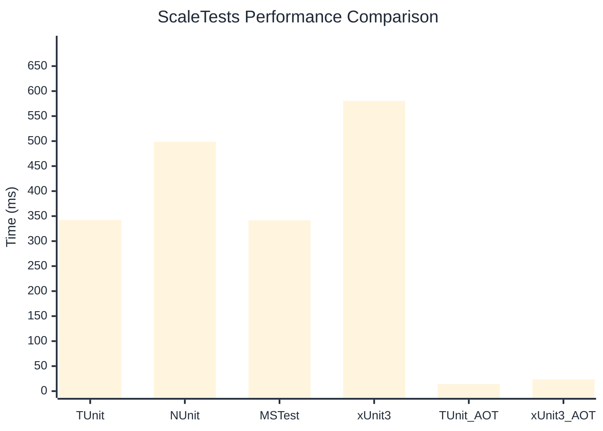

# ScaleTests Benchmark

> Large test suites (150+ tests) measuring scalability

:::info Last Updated
This benchmark was automatically generated on **2026-11-11** from the latest CI run.

**Environment:** Ubuntu Latest • .NET SDK 11.0.100
:::

## 📊 Results

| Framework | Version | Mean | Median | StdDev |
|-----------|---------|------|--------|--------|
| **TUnit** | 1.83.8 | 342.32 ms | 326.32 ms | 44.805 ms |
| NUnit | 5.0.0 | 498.51 ms | 485.39 ms | 58.717 ms |
| MSTest | 4.5.3 | 341.54 ms | 337.71 ms | 32.346 ms |
| xUnit3 | 4.0.3 | 580.54 ms | 552.51 ms | 95.284 ms |
| **TUnit (AOT)** | 1.83.8 | 14.15 ms | 13.91 ms | 1.133 ms |
| xUnit3_AOT | 4.0.3 | 23.43 ms | 22.90 ms | 2.468 ms |

## 📈 Visual Comparison

## 🎯 Key Insights

This benchmark compares TUnit's performance against NUnit, MSTest, xUnit3, xUnit3_AOT using identical test scenarios.

---

:::note Methodology
View the [benchmarks overview](/docs/benchmarks) for methodology details and environment information.
:::

*Last generated: 2026-11-11T22:02:50.440Z*
