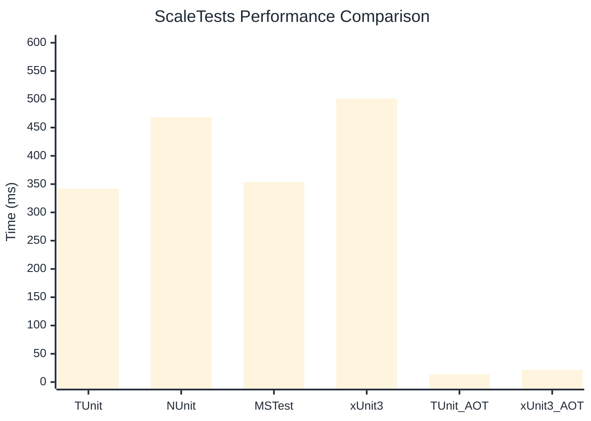

# ScaleTests Benchmark

> Large test suites (150+ tests) measuring scalability

:::info Last Updated
This benchmark was automatically generated on **2026-11-22** from the latest CI run.

**Environment:** Ubuntu Latest • .NET SDK 11.0.100
:::

## 📊 Results

| Framework | Version | Mean | Median | StdDev |
|-----------|---------|------|--------|--------|
| **TUnit** | 1.87.12 | 341.53 ms | 336.91 ms | 24.265 ms |
| NUnit | 5.0.0 | 468.30 ms | 464.51 ms | 35.679 ms |
| MSTest | 4.5.3 | 353.64 ms | 352.43 ms | 30.257 ms |
| xUnit3 | 4.0.3 | 501.31 ms | 497.48 ms | 38.031 ms |
| **TUnit (AOT)** | 1.87.12 | 13.75 ms | 13.70 ms | 0.326 ms |
| xUnit3_AOT | 4.0.3 | 21.62 ms | 21.46 ms | 0.953 ms |

## 📈 Visual Comparison

## 🎯 Key Insights

This benchmark compares TUnit's performance against NUnit, MSTest, xUnit3, xUnit3_AOT using identical test scenarios.

---

:::note Methodology
View the [benchmarks overview](/docs/benchmarks) for methodology details and environment information.
:::

*Last generated: 2026-11-22T00:26:14.013Z*
