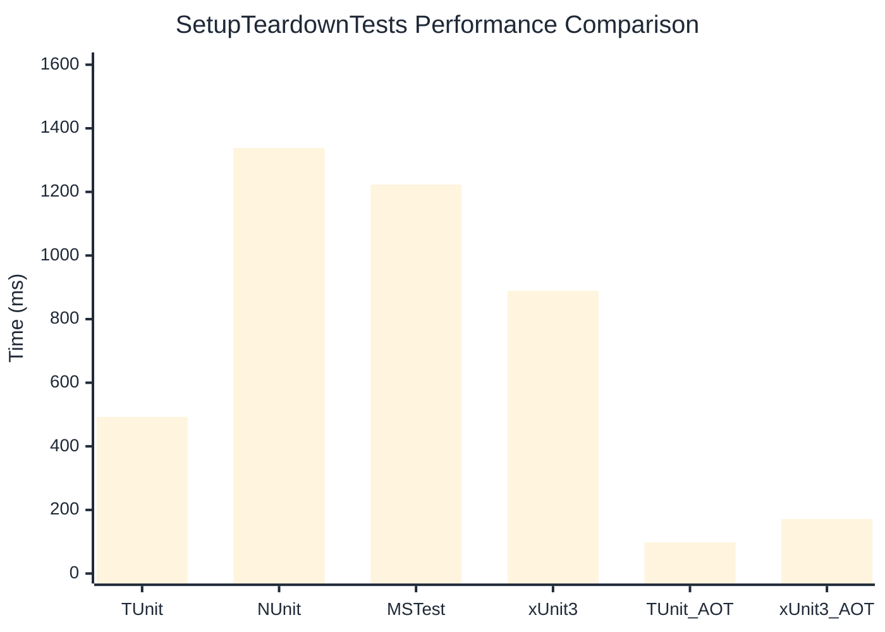

# SetupTeardownTests Benchmark

> Expensive test fixtures with setup/teardown overhead

:::info Last Updated
This benchmark was automatically generated on **2026-11-10** from the latest CI run.

**Environment:** Ubuntu Latest • .NET SDK 11.0.100
:::

## 📊 Results

| Framework | Version | Mean | Median | StdDev |
|-----------|---------|------|--------|--------|
| **TUnit** | 1.81.16 | 492.58 ms | 488.48 ms | 35.529 ms |
| NUnit | 5.0.0 | 1,338.37 ms | 1,329.36 ms | 72.093 ms |
| MSTest | 4.5.2 | 1,223.28 ms | 1,217.90 ms | 39.573 ms |
| xUnit3 | 4.0.3 | 888.97 ms | 886.52 ms | 38.530 ms |
| **TUnit (AOT)** | 1.81.16 | 97.80 ms | 97.78 ms | 0.651 ms |
| xUnit3_AOT | 4.0.3 | 171.34 ms | 171.83 ms | 1.245 ms |

## 📈 Visual Comparison

## 🎯 Key Insights

This benchmark compares TUnit's performance against NUnit, MSTest, xUnit3, xUnit3_AOT using identical test scenarios.

---

:::note Methodology
View the [benchmarks overview](/docs/benchmarks) for methodology details and environment information.
:::

*Last generated: 2026-11-10T19:30:56.052Z*
