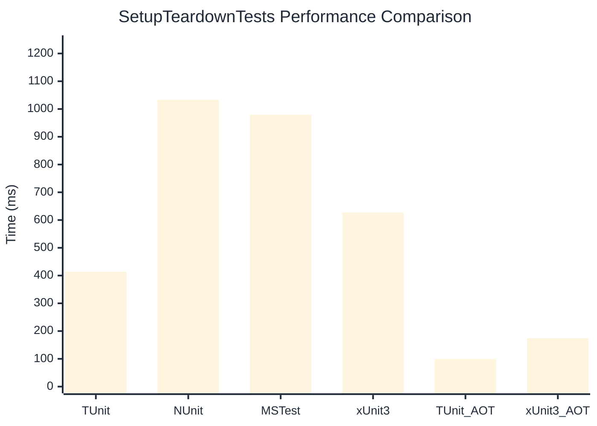

# SetupTeardownTests Benchmark

> Expensive test fixtures with setup/teardown overhead

:::info Last Updated
This benchmark was automatically generated on **2026-11-12** from the latest CI run.

**Environment:** Ubuntu Latest • .NET SDK 11.0.100
:::

## 📊 Results

| Framework | Version | Mean | Median | StdDev |
|-----------|---------|------|--------|--------|
| **TUnit** | 1.84.0 | 413.55 ms | 413.5 ms | 20.195 ms |
| NUnit | 5.0.0 | 1,033.38 ms | 1,036.6 ms | 39.368 ms |
| MSTest | 4.5.3 | 978.96 ms | 979.8 ms | 47.250 ms |
| xUnit3 | 4.0.3 | 626.85 ms | 624.1 ms | 37.452 ms |
| **TUnit (AOT)** | 1.84.0 | 99.37 ms | 100.5 ms | 2.912 ms |
| xUnit3_AOT | 4.0.3 | 174.36 ms | 173.9 ms | 2.592 ms |

## 📈 Visual Comparison

## 🎯 Key Insights

This benchmark compares TUnit's performance against NUnit, MSTest, xUnit3, xUnit3_AOT using identical test scenarios.

---

:::note Methodology
View the [benchmarks overview](/docs/benchmarks) for methodology details and environment information.
:::

*Last generated: 2026-11-12T22:35:43.066Z*
