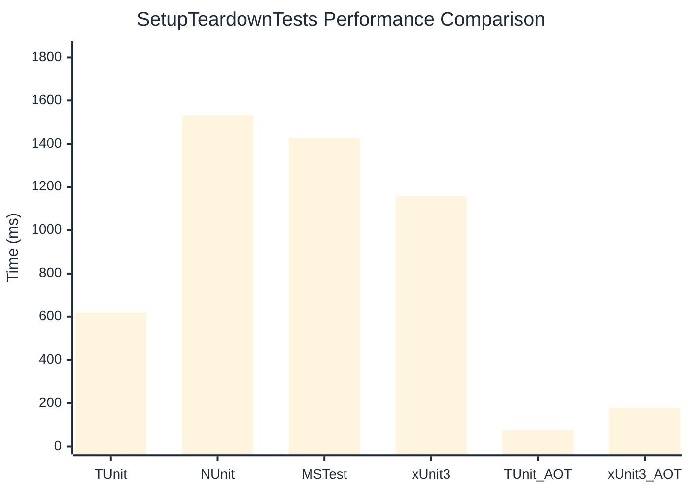

# SetupTeardownTests Benchmark

> Expensive test fixtures with setup/teardown overhead

:::info Last Updated
This benchmark was automatically generated on **2026-10-25** from the latest CI run.

**Environment:** Ubuntu Latest • .NET SDK 10.0.402
:::

## 📊 Results

| Framework | Version | Mean | Median | StdDev |
|-----------|---------|------|--------|--------|
| **TUnit** | 1.76.0 | 617.55 ms | 620.70 ms | 73.403 ms |
| NUnit | 5.0.0 | 1,533.15 ms | 1,554.62 ms | 152.620 ms |
| MSTest | 4.5.1 | 1,425.98 ms | 1,433.02 ms | 108.887 ms |
| xUnit3 | 4.0.2 | 1,156.94 ms | 1,161.98 ms | 131.956 ms |
| **TUnit (AOT)** | 1.76.0 | 76.46 ms | 76.14 ms | 4.078 ms |
| xUnit3_AOT | 4.0.2 | 177.97 ms | 179.00 ms | 2.684 ms |

## 📈 Visual Comparison

## 🎯 Key Insights

This benchmark compares TUnit's performance against NUnit, MSTest, xUnit3, xUnit3_AOT using identical test scenarios.

---

:::note Methodology
View the [benchmarks overview](/docs/benchmarks) for methodology details and environment information.
:::

*Last generated: 2026-10-25T00:37:19.571Z*
