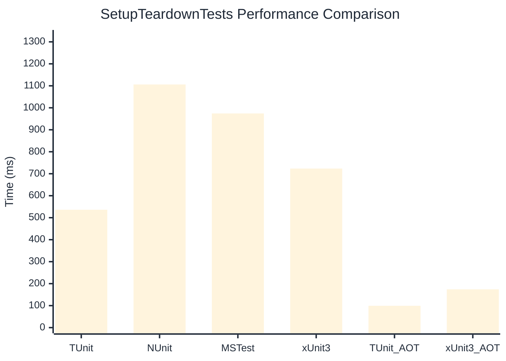

# SetupTeardownTests Benchmark

> Expensive test fixtures with setup/teardown overhead

:::info Last Updated
This benchmark was automatically generated on **2026-11-10** from the latest CI run.

**Environment:** Ubuntu Latest • .NET SDK 11.0.100
:::

## 📊 Results

| Framework | Version | Mean | Median | StdDev |
|-----------|---------|------|--------|--------|
| **TUnit** | 1.81.16 | 536.23 ms | 524.46 ms | 67.678 ms |
| NUnit | 5.0.0 | 1,106.07 ms | 1,106.66 ms | 68.091 ms |
| MSTest | 4.5.2 | 974.33 ms | 967.17 ms | 38.695 ms |
| xUnit3 | 4.0.3 | 723.51 ms | 722.71 ms | 70.855 ms |
| **TUnit (AOT)** | 1.81.16 | 99.36 ms | 98.53 ms | 3.743 ms |
| xUnit3_AOT | 4.0.3 | 174.20 ms | 173.86 ms | 1.304 ms |

## 📈 Visual Comparison

## 🎯 Key Insights

This benchmark compares TUnit's performance against NUnit, MSTest, xUnit3, xUnit3_AOT using identical test scenarios.

---

:::note Methodology
View the [benchmarks overview](/docs/benchmarks) for methodology details and environment information.
:::

*Last generated: 2026-11-10T20:21:13.647Z*
