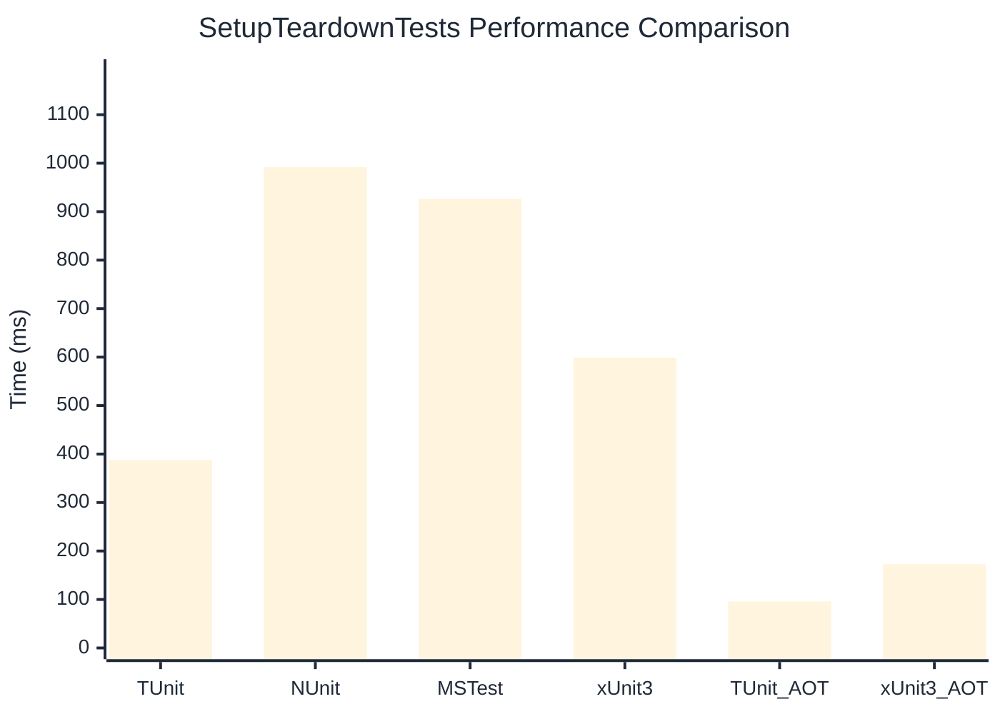

# SetupTeardownTests Benchmark

> Expensive test fixtures with setup/teardown overhead

:::info Last Updated
This benchmark was automatically generated on **2026-11-11** from the latest CI run.

**Environment:** Ubuntu Latest • .NET SDK 11.0.100
:::

## 📊 Results

| Framework | Version | Mean | Median | StdDev |
|-----------|---------|------|--------|--------|
| **TUnit** | 1.83.8 | 387.52 ms | 389.33 ms | 17.888 ms |
| NUnit | 5.0.0 | 992.12 ms | 992.50 ms | 25.121 ms |
| MSTest | 4.5.3 | 926.20 ms | 929.08 ms | 25.917 ms |
| xUnit3 | 4.0.3 | 598.66 ms | 599.12 ms | 30.752 ms |
| **TUnit (AOT)** | 1.83.8 | 95.90 ms | 95.70 ms | 0.972 ms |
| xUnit3_AOT | 4.0.3 | 172.59 ms | 172.26 ms | 1.809 ms |

## 📈 Visual Comparison

## 🎯 Key Insights

This benchmark compares TUnit's performance against NUnit, MSTest, xUnit3, xUnit3_AOT using identical test scenarios.

---

:::note Methodology
View the [benchmarks overview](/docs/benchmarks) for methodology details and environment information.
:::

*Last generated: 2026-11-11T22:02:50.440Z*
