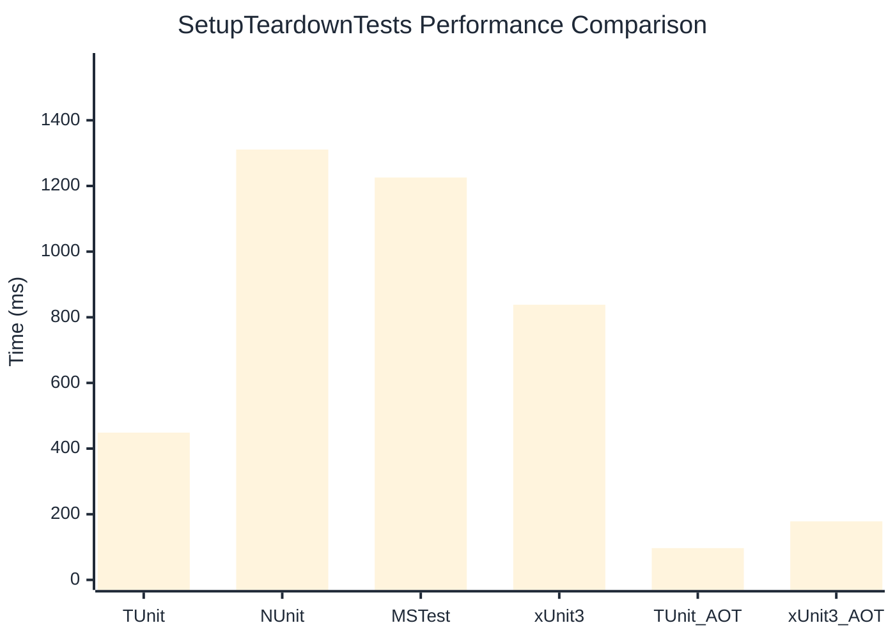

# SetupTeardownTests Benchmark

> Expensive test fixtures with setup/teardown overhead

:::info Last Updated
This benchmark was automatically generated on **2026-11-08** from the latest CI run.

**Environment:** Ubuntu Latest • .NET SDK 10.0.403
:::

## 📊 Results

| Framework | Version | Mean | Median | StdDev |
|-----------|---------|------|--------|--------|
| **TUnit** | 1.81.10 | 448.61 ms | 449.95 ms | 7.810 ms |
| NUnit | 5.0.0 | 1,310.99 ms | 1,311.46 ms | 21.186 ms |
| MSTest | 4.5.2 | 1,225.75 ms | 1,219.95 ms | 24.033 ms |
| xUnit3 | 4.0.2 | 838.25 ms | 837.35 ms | 6.770 ms |
| **TUnit (AOT)** | 1.81.10 | 96.81 ms | 96.89 ms | 1.010 ms |
| xUnit3_AOT | 4.0.2 | 178.42 ms | 177.29 ms | 2.952 ms |

## 📈 Visual Comparison

## 🎯 Key Insights

This benchmark compares TUnit's performance against NUnit, MSTest, xUnit3, xUnit3_AOT using identical test scenarios.

---

:::note Methodology
View the [benchmarks overview](/docs/benchmarks) for methodology details and environment information.
:::

*Last generated: 2026-11-08T00:25:14.106Z*
