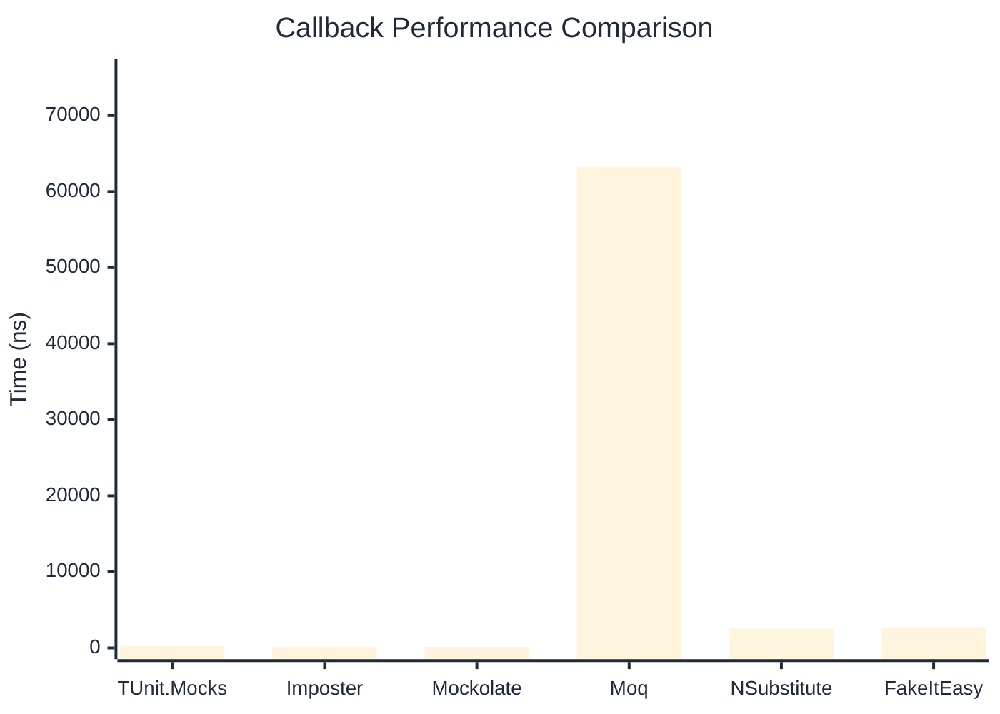

# Callback Benchmark

> Callback registration and execution — comparing **TUnit.Mocks** (source-generated) against other source-generated and runtime proxy-based mocking libraries.

:::info Last Updated
This benchmark was automatically generated on **2026-11-22** from the latest CI run.

**Environment:** Ubuntu Latest • .NET SDK 11.0.100
:::

## 📊 Results

Callback registration and execution:

| Library | Mean | Error | StdDev | Allocated |
|---------|------|-------|--------|-----------|
| **TUnit.Mocks** | 244.5 ns | 4.29 ns | 4.59 ns | 1216 B |
| Imposter | 172.1 ns | 3.30 ns | 3.24 ns | 848 B |
| Mockolate | 150.4 ns | 2.97 ns | 3.53 ns | 832 B |
| Moq | 63,257.5 ns | 1,227.20 ns | 1,313.09 ns | 13577 B |
| NSubstitute | 2,534.8 ns | 33.53 ns | 31.37 ns | 8008 B |
| FakeItEasy | 2,726.4 ns | 36.09 ns | 33.76 ns | 7549 B |

---

### with args

| Library | Mean | Error | StdDev | Allocated |
|---------|------|-------|--------|-----------|
| **TUnit.Mocks** | 320.1 ns | 5.61 ns | 4.69 ns | 1400 B |
| Imposter | 189.8 ns | 3.69 ns | 4.80 ns | 896 B |
| Mockolate | 169.0 ns | 3.11 ns | 2.59 ns | 896 B |
| Moq | 64,250.4 ns | 794.89 ns | 704.65 ns | 13989 B |
| NSubstitute | 2,823.4 ns | 56.21 ns | 64.73 ns | 8584 B |
| FakeItEasy | 3,217.9 ns | 62.18 ns | 80.86 ns | 9624 B |

## 🎯 Key Insights

This benchmark compares **TUnit.Mocks** (source-generated) against other source-generated and runtime proxy-based mocking libraries for callback registration and execution.

---

:::note Methodology
View the [mock benchmarks overview](/docs/benchmarks/mocks) for methodology details and environment information.
:::

*Last generated: 2026-11-22T02:21:53.323Z*
