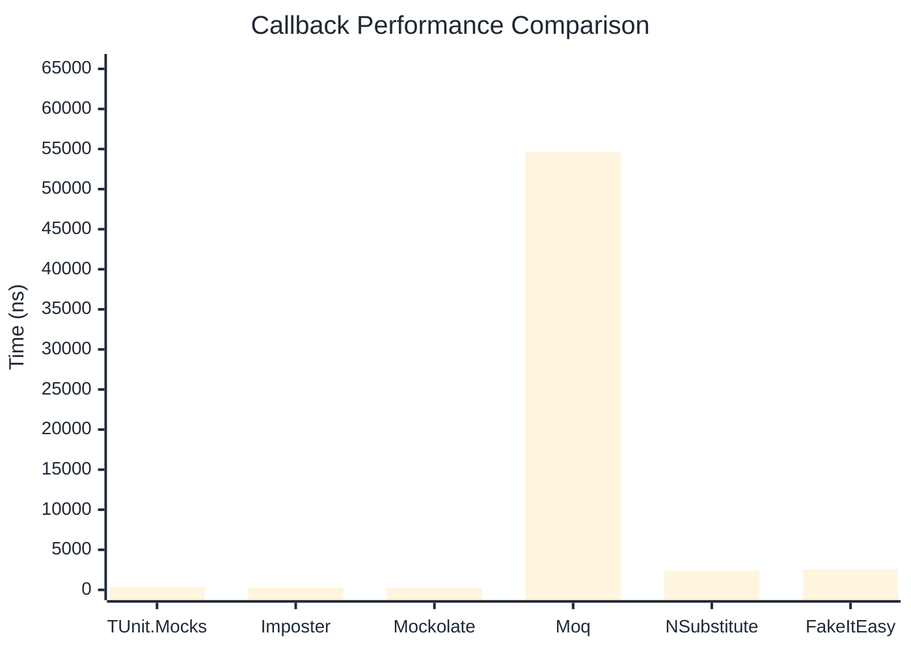
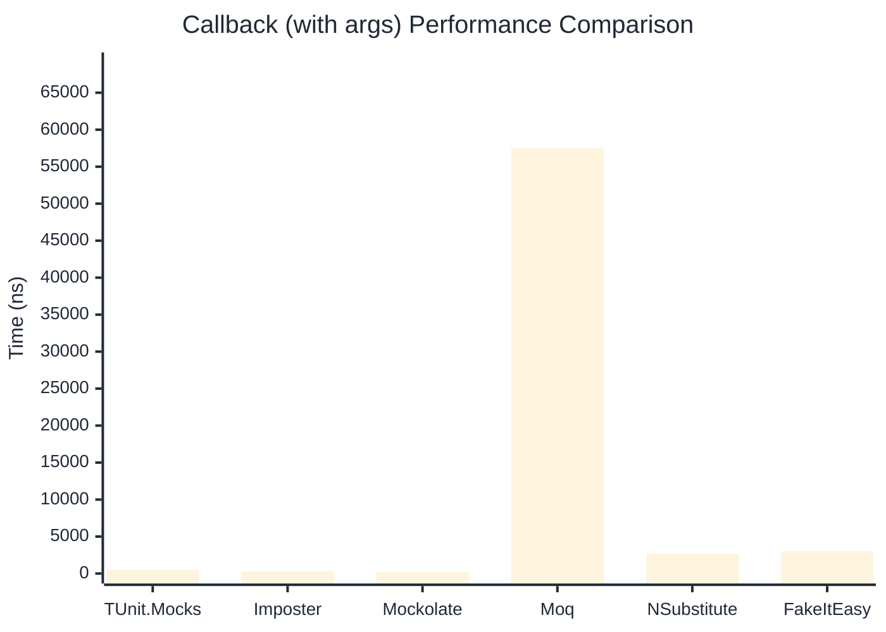

# Callback Benchmark

> Callback registration and execution — comparing **TUnit.Mocks** (source-generated) against runtime proxy-based mocking libraries.

:::info Last Updated
This benchmark was automatically generated on **2026-10-22** from the latest CI run.

**Environment:** Ubuntu Latest • .NET SDK 10.0.402
:::

## 📊 Results

Callback registration and execution:

| Library | Mean | Error | StdDev | Allocated |
|---------|------|-------|--------|-----------|
| **TUnit.Mocks** | 393.7 ns | 4.22 ns | 3.52 ns | 3.13 KB |
| Imposter | 268.9 ns | 3.11 ns | 2.91 ns | 2.61 KB |
| Mockolate | 207.9 ns | 4.05 ns | 3.79 ns | 1.8 KB |
| Moq | 54,647.2 ns | 383.46 ns | 320.20 ns | 13.29 KB |
| NSubstitute | 2,404.8 ns | 47.20 ns | 46.36 ns | 7.85 KB |
| FakeItEasy | 2,575.3 ns | 49.99 ns | 65.00 ns | 7.44 KB |

---

### with args

| Library | Mean | Error | StdDev | Allocated |
|---------|------|-------|--------|-----------|
| **TUnit.Mocks** | 480.8 ns | 9.12 ns | 8.53 ns | 3.23 KB |
| Imposter | 307.1 ns | 2.49 ns | 2.08 ns | 2.77 KB |
| Mockolate | 237.3 ns | 3.04 ns | 2.69 ns | 1.84 KB |
| Moq | 57,572.0 ns | 822.71 ns | 769.56 ns | 13.72 KB |
| NSubstitute | 2,691.8 ns | 52.23 ns | 53.64 ns | 8.41 KB |
| FakeItEasy | 3,019.3 ns | 39.33 ns | 32.84 ns | 9.4 KB |

## 🎯 Key Insights

This benchmark compares **TUnit.Mocks** (source-generated) against runtime proxy-based mocking libraries for callback registration and execution.

---

:::note Methodology
View the [mock benchmarks overview](/docs/benchmarks/mocks) for methodology details and environment information.
:::

*Last generated: 2026-10-22T02:34:37.393Z*
