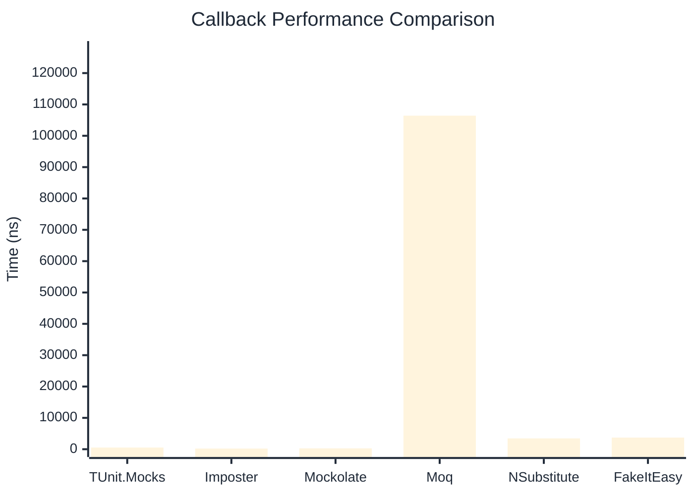

# Callback Benchmark

> Callback registration and execution — comparing **TUnit.Mocks** (source-generated) against runtime proxy-based mocking libraries.

:::info Last Updated
This benchmark was automatically generated on **2026-11-06** from the latest CI run.

**Environment:** Ubuntu Latest • .NET SDK 10.0.403
:::

## 📊 Results

Callback registration and execution:

| Library | Mean | Error | StdDev | Allocated |
|---------|------|-------|--------|-----------|
| **TUnit.Mocks** | 536.5 ns | 1.50 ns | 1.33 ns | 3208 B |
| Imposter | 202.3 ns | 2.06 ns | 1.93 ns | 856 B |
| Mockolate | 270.9 ns | 1.51 ns | 1.26 ns | 1840 B |
| Moq | 106,423.1 ns | 536.52 ns | 501.86 ns | 13605 B |
| NSubstitute | 3,444.8 ns | 33.74 ns | 31.56 ns | 8040 B |
| FakeItEasy | 3,709.9 ns | 8.78 ns | 7.33 ns | 7621 B |

---

### with args

| Library | Mean | Error | StdDev | Allocated |
|---------|------|-------|--------|-----------|
| **TUnit.Mocks** | 608.7 ns | 0.96 ns | 0.80 ns | 3304 B |
| Imposter | 230.1 ns | 1.34 ns | 1.25 ns | 904 B |
| Mockolate | 300.3 ns | 0.97 ns | 0.91 ns | 1888 B |
| Moq | 112,389.0 ns | 382.92 ns | 319.75 ns | 14046 B |
| NSubstitute | 3,946.9 ns | 63.82 ns | 56.57 ns | 8616 B |
| FakeItEasy | 4,437.6 ns | 64.60 ns | 60.43 ns | 9624 B |

## 🎯 Key Insights

This benchmark compares **TUnit.Mocks** (source-generated) against runtime proxy-based mocking libraries for callback registration and execution.

---

:::note Methodology
View the [mock benchmarks overview](/docs/benchmarks/mocks) for methodology details and environment information.
:::

*Last generated: 2026-11-06T02:27:23.366Z*
