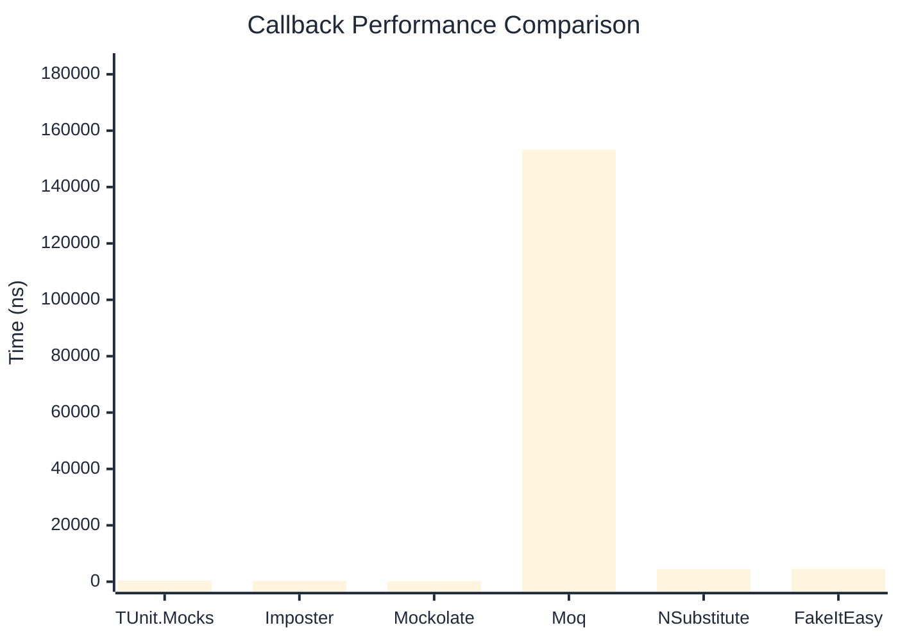

# Callback Benchmark

> Callback registration and execution — comparing **TUnit.Mocks** (source-generated) against other source-generated and runtime proxy-based mocking libraries.

:::info Last Updated
This benchmark was automatically generated on **2026-11-24** from the latest CI run.

**Environment:** Ubuntu Latest • .NET SDK 11.0.100
:::

## 📊 Results

Callback registration and execution:

| Library | Mean | Error | StdDev | Allocated |
|---------|------|-------|--------|-----------|
| **TUnit.Mocks** | 350.7 ns | 1.17 ns | 0.97 ns | 1216 B |
| Imposter | 268.5 ns | 5.04 ns | 4.71 ns | 848 B |
| Mockolate | 218.4 ns | 1.50 ns | 1.33 ns | 832 B |
| Moq | 153,222.8 ns | 772.82 ns | 722.89 ns | 13573 B |
| NSubstitute | 4,471.0 ns | 42.89 ns | 40.12 ns | 8008 B |
| FakeItEasy | 4,542.6 ns | 29.32 ns | 25.99 ns | 7549 B |

---

### with args

| Library | Mean | Error | StdDev | Allocated |
|---------|------|-------|--------|-----------|
| **TUnit.Mocks** | 485.7 ns | 6.33 ns | 5.92 ns | 1400 B |
| Imposter | 286.6 ns | 1.61 ns | 1.34 ns | 896 B |
| Mockolate | 302.7 ns | 3.01 ns | 2.82 ns | 896 B |
| Moq | 160,786.0 ns | 601.41 ns | 562.56 ns | 13990 B |
| NSubstitute | 5,047.5 ns | 26.58 ns | 22.20 ns | 8584 B |
| FakeItEasy | 5,615.9 ns | 54.24 ns | 50.73 ns | 9744 B |

## 🎯 Key Insights

This benchmark compares **TUnit.Mocks** (source-generated) against other source-generated and runtime proxy-based mocking libraries for callback registration and execution.

---

:::note Methodology
View the [mock benchmarks overview](/docs/benchmarks/mocks) for methodology details and environment information.
:::

*Last generated: 2026-11-24T02:20:52.556Z*
