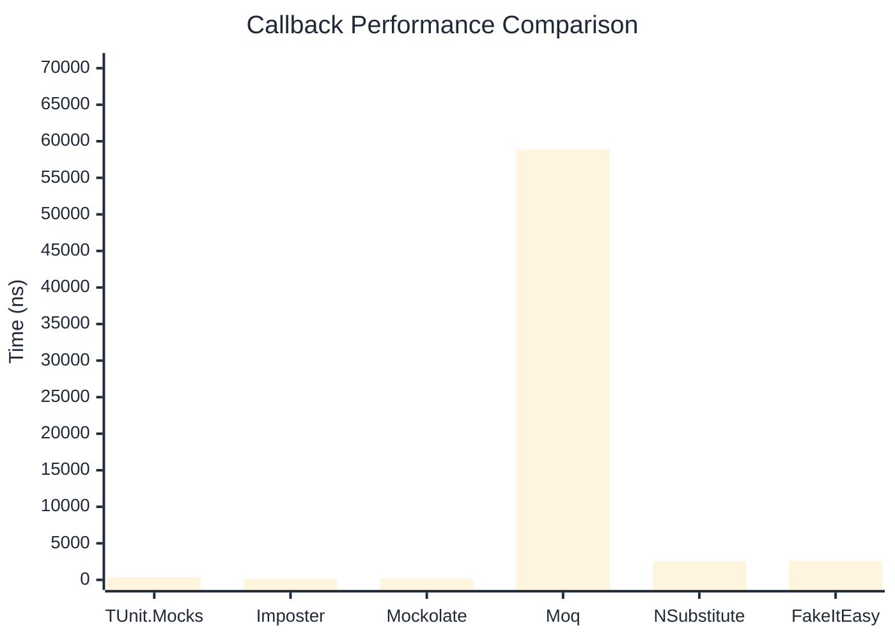
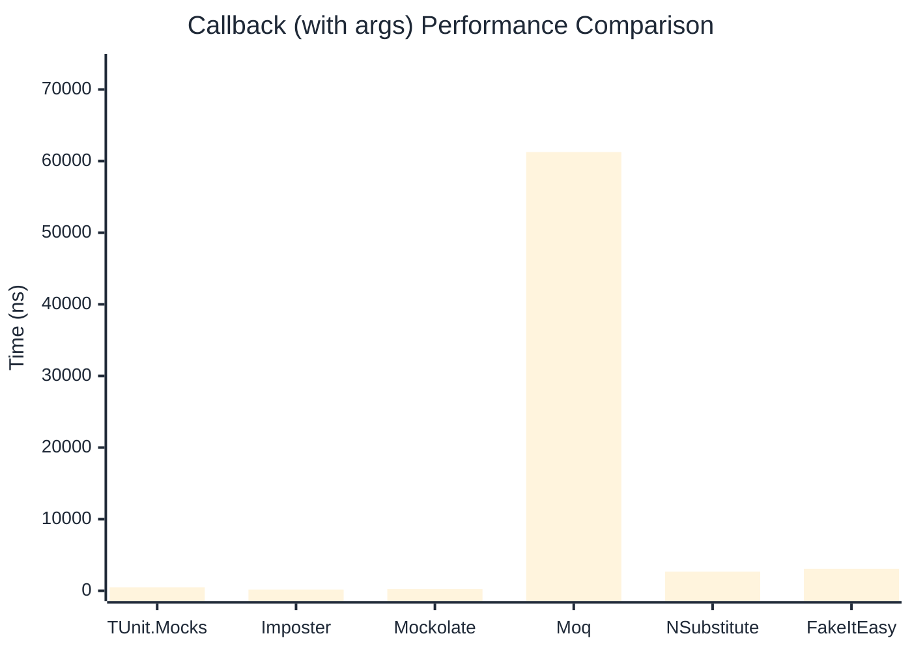

# Callback Benchmark

> Callback registration and execution — comparing **TUnit.Mocks** (source-generated) against runtime proxy-based mocking libraries.

:::info Last Updated
This benchmark was automatically generated on **2026-11-16** from the latest CI run.

**Environment:** Ubuntu Latest • .NET SDK 11.0.100
:::

## 📊 Results

Callback registration and execution:

| Library | Mean | Error | StdDev | Allocated |
|---------|------|-------|--------|-----------|
| **TUnit.Mocks** | 390.9 ns | 7.79 ns | 17.43 ns | 3200 B |
| Imposter | 156.6 ns | 3.11 ns | 3.05 ns | 848 B |
| Mockolate | 207.0 ns | 3.99 ns | 5.72 ns | 1824 B |
| Moq | 58,903.4 ns | 1,138.57 ns | 1,311.18 ns | 13577 B |
| NSubstitute | 2,522.8 ns | 49.34 ns | 58.74 ns | 8008 B |
| FakeItEasy | 2,559.4 ns | 50.77 ns | 104.85 ns | 7549 B |

---

### with args

| Library | Mean | Error | StdDev | Allocated |
|---------|------|-------|--------|-----------|
| **TUnit.Mocks** | 475.3 ns | 8.42 ns | 16.01 ns | 3296 B |
| Imposter | 170.9 ns | 2.78 ns | 2.60 ns | 896 B |
| Mockolate | 239.2 ns | 4.05 ns | 3.59 ns | 1872 B |
| Moq | 61,257.2 ns | 661.80 ns | 619.05 ns | 13989 B |
| NSubstitute | 2,677.5 ns | 52.52 ns | 84.82 ns | 8584 B |
| FakeItEasy | 3,063.4 ns | 58.70 ns | 65.25 ns | 9624 B |

## 🎯 Key Insights

This benchmark compares **TUnit.Mocks** (source-generated) against runtime proxy-based mocking libraries for callback registration and execution.

---

:::note Methodology
View the [mock benchmarks overview](/docs/benchmarks/mocks) for methodology details and environment information.
:::

*Last generated: 2026-11-16T02:25:25.447Z*
