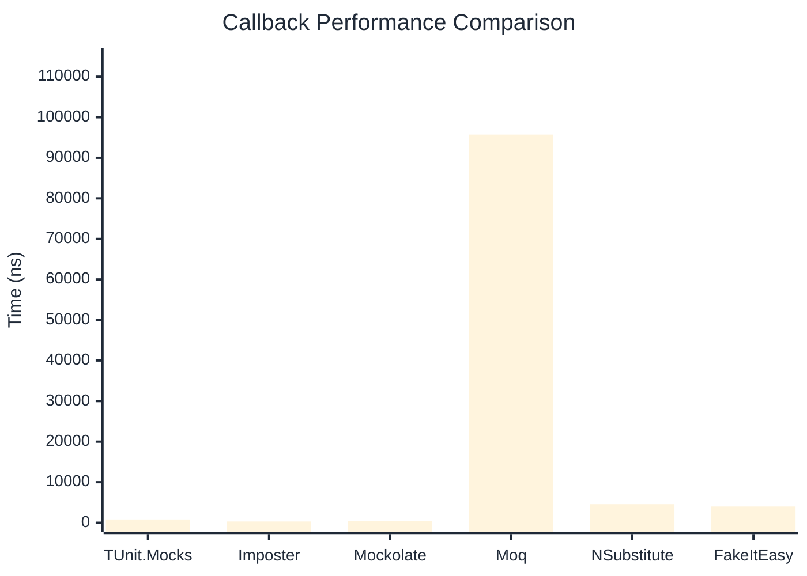
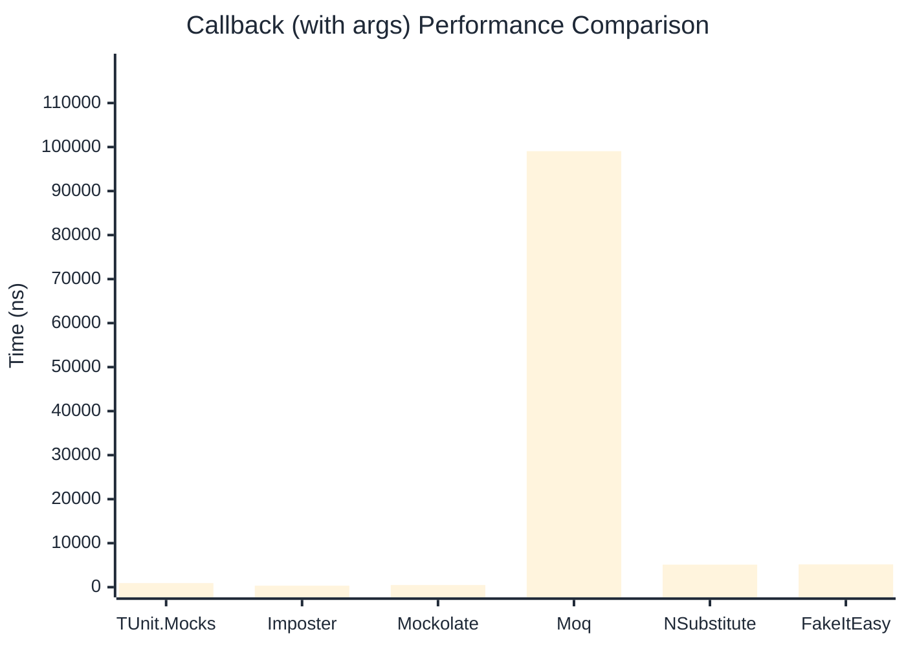

# Callback Benchmark

> Callback registration and execution — comparing **TUnit.Mocks** (source-generated) against runtime proxy-based mocking libraries.

:::info Last Updated
This benchmark was automatically generated on **2026-11-14** from the latest CI run.

**Environment:** Ubuntu Latest • .NET SDK 11.0.100
:::

## 📊 Results

Callback registration and execution:

| Library | Mean | Error | StdDev | Allocated |
|---------|------|-------|--------|-----------|
| **TUnit.Mocks** | 803.3 ns | 7.37 ns | 6.53 ns | 3200 B |
| Imposter | 308.9 ns | 0.61 ns | 0.54 ns | 848 B |
| Mockolate | 434.6 ns | 2.54 ns | 2.38 ns | 1824 B |
| Moq | 95,726.2 ns | 1,014.48 ns | 899.31 ns | 13565 B |
| NSubstitute | 4,585.1 ns | 32.18 ns | 26.87 ns | 8008 B |
| FakeItEasy | 4,003.5 ns | 30.23 ns | 26.80 ns | 7542 B |

---

### with args

| Library | Mean | Error | StdDev | Allocated |
|---------|------|-------|--------|-----------|
| **TUnit.Mocks** | 924.6 ns | 5.66 ns | 4.72 ns | 3296 B |
| Imposter | 332.4 ns | 3.30 ns | 3.09 ns | 896 B |
| Mockolate | 482.4 ns | 6.80 ns | 6.03 ns | 1872 B |
| Moq | 99,060.8 ns | 856.64 ns | 759.39 ns | 14140 B |
| NSubstitute | 5,117.8 ns | 52.63 ns | 46.66 ns | 8584 B |
| FakeItEasy | 5,171.4 ns | 44.24 ns | 36.94 ns | 9638 B |

## 🎯 Key Insights

This benchmark compares **TUnit.Mocks** (source-generated) against runtime proxy-based mocking libraries for callback registration and execution.

---

:::note Methodology
View the [mock benchmarks overview](/docs/benchmarks/mocks) for methodology details and environment information.
:::

*Last generated: 2026-11-14T02:21:36.343Z*
