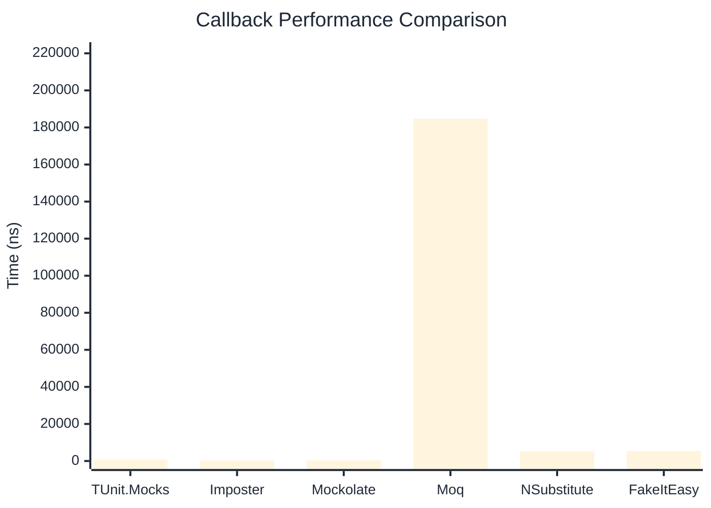
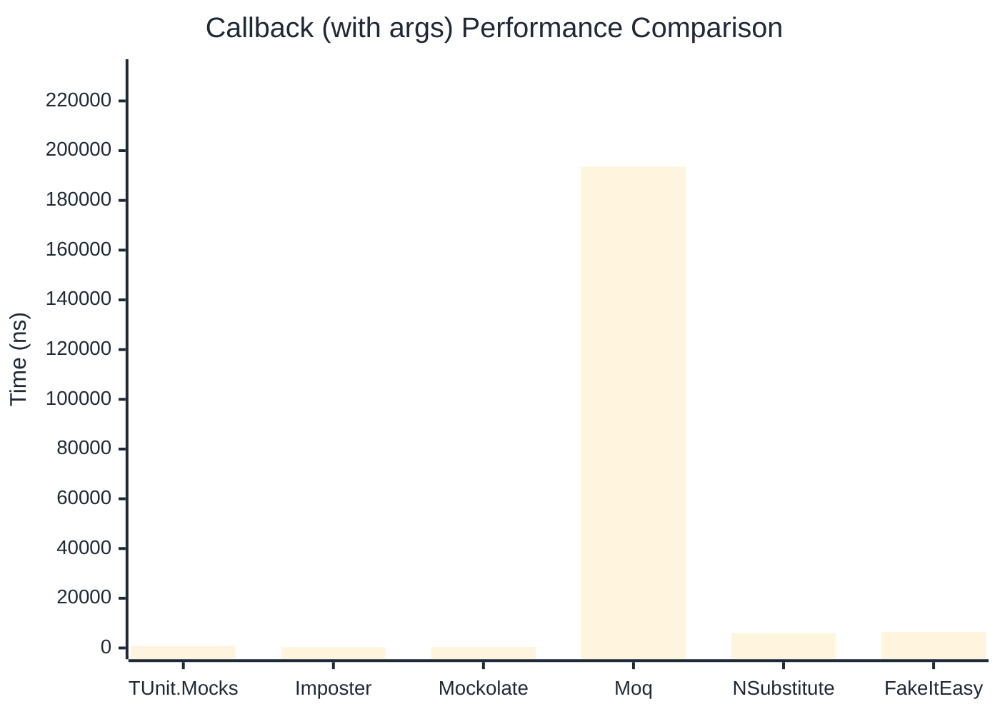

# Callback Benchmark

> Callback registration and execution — comparing **TUnit.Mocks** (source-generated) against runtime proxy-based mocking libraries.

:::info Last Updated
This benchmark was automatically generated on **2026-11-01** from the latest CI run.

**Environment:** Ubuntu Latest • .NET SDK 10.0.403
:::

## 📊 Results

Callback registration and execution:

| Library | Mean | Error | StdDev | Allocated |
|---------|------|-------|--------|-----------|
| **TUnit.Mocks** | 723.4 ns | 10.44 ns | 9.77 ns | 3.13 KB |
| Imposter | 304.9 ns | 3.16 ns | 2.80 ns | 1 KB |
| Mockolate | 365.7 ns | 2.41 ns | 2.01 ns | 1.8 KB |
| Moq | 184,729.2 ns | 811.08 ns | 719.00 ns | 13.14 KB |
| NSubstitute | 5,070.8 ns | 26.45 ns | 24.74 ns | 7.85 KB |
| FakeItEasy | 5,410.3 ns | 35.21 ns | 29.40 ns | 7.44 KB |

---

### with args

| Library | Mean | Error | StdDev | Allocated |
|---------|------|-------|--------|-----------|
| **TUnit.Mocks** | 821.4 ns | 7.63 ns | 6.76 ns | 3.23 KB |
| Imposter | 345.1 ns | 5.85 ns | 5.47 ns | 1.09 KB |
| Mockolate | 439.3 ns | 8.34 ns | 7.80 ns | 1.84 KB |
| Moq | 193,512.3 ns | 692.96 ns | 578.66 ns | 13.81 KB |
| NSubstitute | 5,877.2 ns | 37.52 ns | 35.10 ns | 8.41 KB |
| FakeItEasy | 6,528.5 ns | 95.71 ns | 89.53 ns | 9.26 KB |

## 🎯 Key Insights

This benchmark compares **TUnit.Mocks** (source-generated) against runtime proxy-based mocking libraries for callback registration and execution.

---

:::note Methodology
View the [mock benchmarks overview](/docs/benchmarks/mocks) for methodology details and environment information.
:::

*Last generated: 2026-11-01T02:27:32.250Z*
