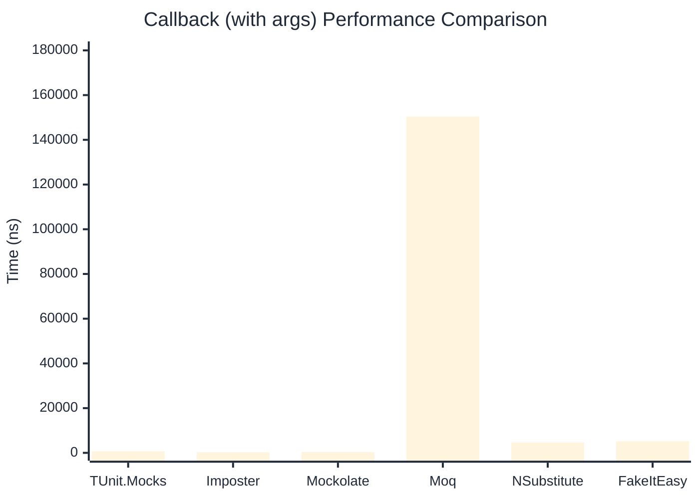

# Callback Benchmark

> Callback registration and execution — comparing **TUnit.Mocks** (source-generated) against runtime proxy-based mocking libraries.

:::info Last Updated
This benchmark was automatically generated on **2026-11-15** from the latest CI run.

**Environment:** Ubuntu Latest • .NET SDK 11.0.100
:::

## 📊 Results

Callback registration and execution:

| Library | Mean | Error | StdDev | Allocated |
|---------|------|-------|--------|-----------|
| **TUnit.Mocks** | 566.2 ns | 11.28 ns | 31.64 ns | 3200 B |
| Imposter | 246.1 ns | 4.90 ns | 10.86 ns | 848 B |
| Mockolate | 297.8 ns | 6.13 ns | 18.06 ns | 1824 B |
| Moq | 140,478.3 ns | 2,808.21 ns | 4,288.43 ns | 13573 B |
| NSubstitute | 4,150.5 ns | 81.89 ns | 109.32 ns | 8008 B |
| FakeItEasy | 4,091.6 ns | 80.94 ns | 193.93 ns | 7549 B |

---

### with args

| Library | Mean | Error | StdDev | Allocated |
|---------|------|-------|--------|-----------|
| **TUnit.Mocks** | 689.1 ns | 13.77 ns | 35.29 ns | 3296 B |
| Imposter | 260.8 ns | 5.15 ns | 11.19 ns | 896 B |
| Mockolate | 363.6 ns | 7.19 ns | 7.70 ns | 1872 B |
| Moq | 150,392.9 ns | 2,918.05 ns | 3,122.28 ns | 13990 B |
| NSubstitute | 4,601.6 ns | 92.03 ns | 239.19 ns | 8584 B |
| FakeItEasy | 5,168.3 ns | 103.09 ns | 287.37 ns | 9624 B |

## 🎯 Key Insights

This benchmark compares **TUnit.Mocks** (source-generated) against runtime proxy-based mocking libraries for callback registration and execution.

---

:::note Methodology
View the [mock benchmarks overview](/docs/benchmarks/mocks) for methodology details and environment information.
:::

*Last generated: 2026-11-15T02:24:17.223Z*
