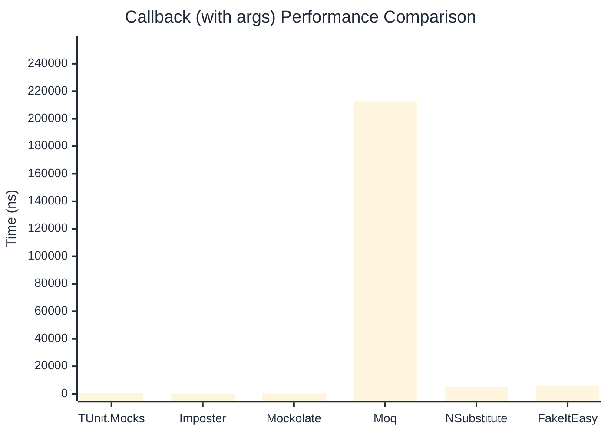

# Callback Benchmark

> Callback registration and execution — comparing **TUnit.Mocks** (source-generated) against runtime proxy-based mocking libraries.

:::info Last Updated
This benchmark was automatically generated on **2026-11-17** from the latest CI run.

**Environment:** Ubuntu Latest • .NET SDK 11.0.100
:::

## 📊 Results

Callback registration and execution:

| Library | Mean | Error | StdDev | Allocated |
|---------|------|-------|--------|-----------|
| **TUnit.Mocks** | 622.7 ns | 6.89 ns | 6.44 ns | 3200 B |
| Imposter | 238.8 ns | 0.80 ns | 0.71 ns | 848 B |
| Mockolate | 313.1 ns | 2.44 ns | 2.17 ns | 1744 B |
| Moq | 203,087.7 ns | 487.33 ns | 455.85 ns | 13573 B |
| NSubstitute | 4,758.9 ns | 25.73 ns | 24.07 ns | 8008 B |
| FakeItEasy | 4,677.3 ns | 37.13 ns | 34.74 ns | 7549 B |

---

### with args

| Library | Mean | Error | StdDev | Allocated |
|---------|------|-------|--------|-----------|
| **TUnit.Mocks** | 722.5 ns | 5.36 ns | 5.02 ns | 3296 B |
| Imposter | 263.9 ns | 2.87 ns | 2.54 ns | 896 B |
| Mockolate | 354.6 ns | 1.53 ns | 1.36 ns | 1744 B |
| Moq | 212,625.2 ns | 707.74 ns | 627.39 ns | 13987 B |
| NSubstitute | 5,204.2 ns | 29.91 ns | 26.52 ns | 8584 B |
| FakeItEasy | 5,912.2 ns | 34.11 ns | 31.91 ns | 9624 B |

## 🎯 Key Insights

This benchmark compares **TUnit.Mocks** (source-generated) against runtime proxy-based mocking libraries for callback registration and execution.

---

:::note Methodology
View the [mock benchmarks overview](/docs/benchmarks/mocks) for methodology details and environment information.
:::

*Last generated: 2026-11-17T02:23:59.645Z*
