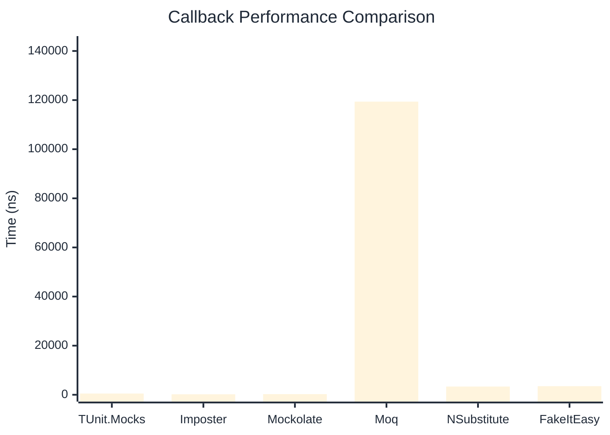

# Callback Benchmark

> Callback registration and execution — comparing **TUnit.Mocks** (source-generated) against runtime proxy-based mocking libraries.

:::info Last Updated
This benchmark was automatically generated on **2026-11-11** from the latest CI run.

**Environment:** Ubuntu Latest • .NET SDK 11.0.100
:::

## 📊 Results

Callback registration and execution:

| Library | Mean | Error | StdDev | Allocated |
|---------|------|-------|--------|-----------|
| **TUnit.Mocks** | 501.2 ns | 5.10 ns | 4.52 ns | 3200 B |
| Imposter | 199.6 ns | 2.69 ns | 2.51 ns | 848 B |
| Mockolate | 258.5 ns | 3.76 ns | 3.33 ns | 1824 B |
| Moq | 119,376.5 ns | 841.47 ns | 787.11 ns | 13573 B |
| NSubstitute | 3,353.9 ns | 14.14 ns | 11.04 ns | 8008 B |
| FakeItEasy | 3,506.8 ns | 21.80 ns | 20.39 ns | 7549 B |

---

### with args

| Library | Mean | Error | StdDev | Allocated |
|---------|------|-------|--------|-----------|
| **TUnit.Mocks** | 591.6 ns | 6.34 ns | 5.29 ns | 3296 B |
| Imposter | 299.7 ns | 10.19 ns | 30.05 ns | 896 B |
| Mockolate | 291.9 ns | 3.96 ns | 3.51 ns | 1872 B |
| Moq | 125,075.2 ns | 670.31 ns | 627.00 ns | 13990 B |
| NSubstitute | 3,806.3 ns | 68.82 ns | 53.73 ns | 8584 B |
| FakeItEasy | 4,398.1 ns | 66.66 ns | 62.36 ns | 9744 B |

## 🎯 Key Insights

This benchmark compares **TUnit.Mocks** (source-generated) against runtime proxy-based mocking libraries for callback registration and execution.

---

:::note Methodology
View the [mock benchmarks overview](/docs/benchmarks/mocks) for methodology details and environment information.
:::

*Last generated: 2026-11-11T02:20:11.802Z*
